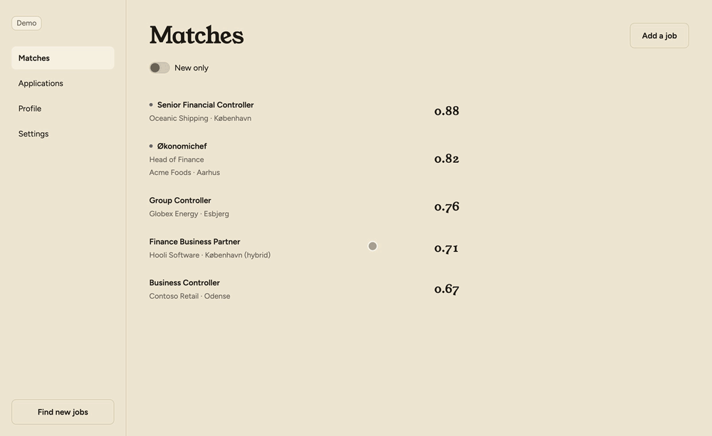

# The other door

**Finding your next job, the way it should be.**


[](docs/badges/live-smoke.md#boards)
[](docs/badges/live-smoke.md#employer-feeds)
[](docs/badges/live-smoke.md#countries)
[](docs/badges/live-smoke.md#languages)
[](docs/badges/live-smoke.md#matcher)

A job search that runs on your computer: it gathers new job ads from public job boards and
employers' own job feeds, scores each one against your CV, and writes a tailored CV and cover
letter for the ones worth applying to. Drive it by talking to
[Claude Code](https://docs.claude.com/en/docs/claude-code) ("get me today's jobs",
"prepare the Acme one") or with plain shell commands (`./door find`, `./door jobs prepare acme`). Both do
the same things. Every model call runs on your Claude Pro/Max plan through the `claude`
CLI, so there's no API key. You submit the applications yourself.

## Getting started

You need a **Claude Pro or Max plan**, whichever way you drive *The other door*: it makes its model
calls through the `claude` CLI on your plan. The quickest start is the [desktop app](#desktop-app):
one installer, nothing else to set up. To use *The other door* from Claude Code or the terminal, clone it;
everything else, including Python 3.12 and the `claude` CLI, is installed for you:

```bash
git clone https://github.com/synesenom/the-other-door.git && cd the-other-door
./scripts/setup.sh          # Windows: .\scripts\setup.ps1
claude auth login           # sign in with your Pro/Max account
```

The script asks once, then installs whatever is missing, one line and a checkmark each:
Python 3.12, Poetry, the Python packages, [Tectonic](https://tectonic-typesetting.github.io)
(a small TeX engine for the PDFs, no sudo), and the `claude` CLI. It
ends by checking that Claude Code can start *The other door*'s MCP server. Re-run it any time to
repair an install; `--yes` skips the question.

From here you drive *The other door* either from a Claude Code conversation or from the terminal.
The two do the same things with the same options — every command is also a tool — so pick
the one you prefer, or mix them.

### Desktop app

Download the installer for your computer from the [latest release](https://github.com/synesenom/the-other-door/releases/latest)
(macOS `.dmg`, Windows `.exe`, Linux AppImage or `.deb`) and open it. It carries everything *The other door*
needs; the first launch installs the `claude` CLI if it is missing, signs you in to your plan and
sets up your profile. On macOS, allow it once the first time you open it
([how](docs/manual-app.md#opening-it-on-macos-the-first-time)). The app's screens, where
your data lives and how to uninstall are in the [app's manual](docs/manual-app.md). It uses the
same data as the other two when you point `DOOR_HOME` at it.



### Claude Code

Open the repo in Claude Code and say `/onboard`:

```bash
claude
```

`/onboard` finishes the setup in a conversation: it reads your sources (a CV in PDF, DOCX or
Markdown, a LinkedIn PDF, public pages), drafts `profile/cv.md`, infers your details, job titles
and search terms, asks only for what it could not find, and shows it all in one review — nothing
is written until you confirm. Then it starts the first search. Everything it writes stays in `profile/`, which is gitignored.

From then on, a session is a conversation:

| You say | What happens |
|---------|--------------|
| "Get me today's jobs." | Searches the job boards in your profile, finds the employers' own job feeds and reads them (only what's new since last time), filters out what can't fit, scores the rest against your CV, and shows the ranked matches. A few minutes. |
| "What's new?" | What happened since you last looked, then the new matches, best first. |
| "Show me 3." | The posting in full. |
| "Not 2, it's on-site." | Hides it, with your reason. |
| "Prepare 3." | A tailored CV and cover letter, compiled to PDF (a few minutes). |
| "Let me see it." | Both PDFs with page images, keywords, page counts and letter length. |
| "Tighten the letter's second paragraph." | One targeted edit, recompiled. "Undo that" reverts it. |
| "Here's an ad I found: …" | Stores a pasted ad (or fetches a link) as a posting so you can prepare it. |
| "Mark 3 applied." | Records it — you submit the application yourself. |
| "I passed the screening at 3; technical interview on Friday." | Records each interview round (screening, impression, assessment, technical), so you can see later which kinds you pass. |
| "I'm done." | Closes the review session, so next time "new" means new since now. |


The PDFs are in `jobs/output/<job_id>/`. The full list of things you can say, the skills
(`/expand`, `/upskill`) and the MCP server behind it all: [*The other door* in Claude Code](docs/manual-claude.md).

### CLI

The same steps as shell commands, run from the repo checkout (Windows: `.\door`):

```bash
./door init                       # set up: your sources, one review, a first run

./door find                        # search, find employers' feeds, collect, score; show the best matches
./door jobs show acme              # read a posting, named by its company or title (several: pick one)
./door jobs prepare acme           # tailored CV + cover letter (a few minutes)
./door jobs show acme --open       # the posting plus what was tailored, and the PDFs in your viewer
./door jobs status                # record it (pick the job and status from lists) — you submit the application yourself
```


Not happy with the letter or the CV? Open Claude Code here (`claude`) and ask: "tighten the letter's second paragraph" — it edits and recompiles the PDF.

Every command and every option: [*The other door* from the terminal](docs/manual-cli.md).

## Supported countries

Denmark, France, Hungary, Sweden and the United Kingdom: `find` searches the public job boards that
cover your `location`'s country, and reads the job feeds of the employers you follow, wherever they
are. `./door companies add <name>` follows one (most applicant-tracking systems, and any career
site that publishes job markup); `./door companies` lists them. Each `find` can also first look,
only for the sources you turn on, at which employers hire for your keywords, and follow their own
job feeds. The sites, country by country: [Job sites](docs/job-sites.md).

*The other door* keeps job ads written in English, Danish, French, Hungarian or Swedish (your choice,
`languages` in the profile)
and drops the rest. Your country's boards missing? Adding
them is a self-contained contribution: [Adding a site or a country](docs/adding-a-site.md).

## What The other door fetches

Job feeds and career pages that employers publish (their applicant-tracking systems' job
feeds, the sitemaps and job markup they publish for search engines), and job boards whose
terms don't forbid it. Every request is logged out, skips any site whose terms reserve its
content and is paced per host (honouring `Crawl-delay`); there is no CAPTCHA solving, no proxying
and no login anywhere. The sources it asks only which employers hire (never for their job ads)
are off until you turn them on, and are read slowly, in small capped batches, stopping at the
first sign of pushback ([details](docs/job-sites.md#how-the-other-door-fetches)). The postings it reads are
stored on your computer for your own job search and never redistributed; each keeps a link
back to its source. You are responsible for the sites you configure (see [Job sites](docs/job-sites.md#all-sites)); read the
[legal disclaimer](LEGAL_DISCLAIMER.md) before you run it. *The other door* is MIT-licensed
([LICENSE](LICENSE)).

## Documentation

| Doc | What's in it |
|-----|--------------|
| [*The other door* in Claude Code](docs/manual-claude.md) | Onboarding and a review session in a conversation: what you can say, the skills, and the MCP server behind it. |
| [The desktop app](docs/manual-app.md) | Installing it, the first launch, every screen, where your data lives, updating and uninstalling. |
| [*The other door* from the terminal](docs/manual-cli.md) | The same pipeline as shell commands: the walkthrough, every command and its options, scheduling. |
| [Claude Code skills](docs/skills.md) | `/onboard`, `/expand`, `/upskill`, the developer skills and the agents. |
| [Configuration](docs/configuration.md) | `profile/config.json`: creating it, validation, every key. |
| [Job sites](docs/job-sites.md) | Supported sites, per-company feeds, and the sources that find employers. |
| [Adding a site or a country](docs/adding-a-site.md) | Adding the job boards of your country. |
| [Your data](docs/data.md) | Where your profile, postings and generated materials live, what is sent to Anthropic and Google Drive, and how to back them up. Google Drive: [privacy](https://enysmones.com/the-other-door/#privacy). |
| [How it works](docs/how-it-works.md) | The pipeline, freshness ("only what's new"), plan usage, project status. |
| [Architecture](docs/architecture.md) | How the code is organised. |
| [CONTRIBUTING.md](CONTRIBUTING.md) | Working on *The other door*: tests, conventions, adding a scraper. |

## Project layout

```
door/
├── door              # the command line: ./door <command> (Windows: .\door)
├── src/door/         # all pipeline code (CLI, MCP server, scrapers, matching, tailoring)
├── profile.example/    # a fake example profile to start from
├── profile/            # your profile (config, CV, templates) — gitignored
├── jobs/               # postings, scores, materials, run records — gitignored
├── scripts/            # setup.sh, setup.ps1, run-test.sh
├── docs/               # documentation
├── tests/              # unit / fixture / live tests
├── .claude/            # Claude Code agents and skills
└── .mcp.json           # registers the MCP server for Claude Code
```
