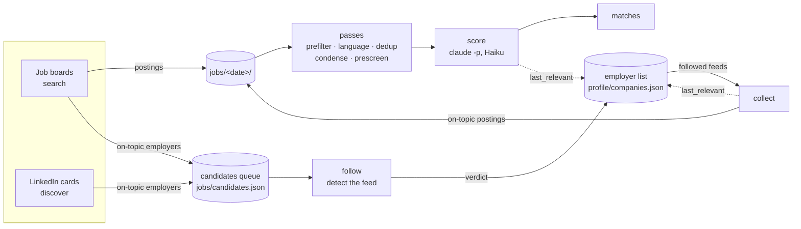
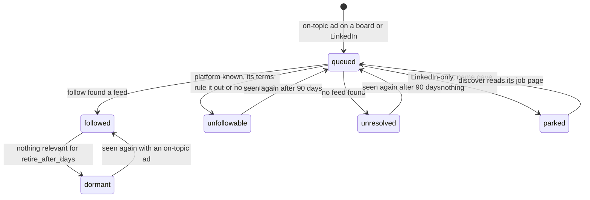

# Architecture

*The other door* scrapes job boards, scores postings against a candidate profile, and generates tailored application materials. This document describes how the code is organised so you know where to look. For using it, see [README.md](../README.md); for working on it, [CONTRIBUTING.md](../CONTRIBUTING.md).

Start with [The engine](#the-engine): it explains how `find` works and why. The sections after it are the reference: modules, files, contracts.

## The engine

### The idea

Job boards show only part of the market, and a late part. Most employers post first, and sometimes only, on their own applicant-tracking system (Greenhouse, Lever, TeamTailor, Workday, …). So *The other door* uses the boards and LinkedIn for two jobs: they are job sources, and they tell *The other door* **which employers hire for the candidate's kind of role**. *The other door* then **follows** those employers' own feeds directly. Over time the list of followed employers (`profile/companies.json`) becomes the main source, and the boards keep feeding it new names.

Everything else is there to keep that loop cheap and polite and its results relevant. Postings are filtered offline before any model sees them, and a model is called only where judgment is needed: scoring, and a few fallbacks.

### The flow



Each step does one thing and leaves state on disk that the next step reads:

- **`search`** reads the boards that serve the profile's country with `search_keywords`. It writes the postings and queues the employer of every **on-topic** posting.
- **`discover`** reads LinkedIn's public search cards, which are not used as postings, and queues their employers. It runs on a background thread during a full `find`, because LinkedIn has to be read slowly (see [How the pieces fit](#how-the-pieces-fit)).
- **`follow`** takes each queued employer and works out where its jobs are published, then records a verdict for it in the employer list.
- **`collect`** reads every followed employer's feed and writes the on-topic postings.
- **`match`** runs the offline passes once over everything new, then scores what survives.

`search` and `collect` share one engine, `_scrape_core`, which runs the scrapers concurrently and handles outcomes, history and pacing. Only its mode differs, which decides which sites run and how freshness is judged.

### The life of an employer

An employer enters the system when it appears in the queue, and from then on its record in `profile/companies.json` holds its state:



- **Queued** (`jobs/candidates.json`, `core/candidates.py`): the employer's name, its links (apply links, careers hosts) and the titles that put it there. Entries not seen for `max_age_days` expire. An employer already *settled* in the list is not queued again (`companies.is_settled`): it is followed, or it was judged less than `RETRY_DAYS` (90) ago.
- **Follow's verdict** (`commands/companies._classify`) tries each method until one works:
  1. the shape of each link
  2. the DNS name (CNAME) of the careers host
  3. the careers page and the pages it links to (two hops at most)
  4. the employer's name, tried as likely slugs on every platform's public endpoint
  5. the employer's own website, read from Wikidata by its name (`core/wikidata.py`, #566): the name trimmed of its legal form and of the words a subsidiary's name ends with (`subsidiary_words` in `i18n/common.toml` and the country files, and the countries' names: "Telia Sverige AB" is searched as "Telia Sverige", then "Telia"), the hits whose label or alias is that name (`companies.name_key`), the organisation among them (an item with the statements only an organisation has), one in the profile's country first, with its official website (P856) and its parent organisation's (P749). `companies._by_website` reads each website as any link (its careers pages, two hops), then the careers hosts of its domain (`career.hm.com`, the labels of `_site_labels`), then each platform's `tenant_probe` with the names' and domains' slugs (Workday: `<slug>.wdN.myworkdayjobs.com/robots.txt`). Two searches and one or two entity reads per employer, each name once a run, at most `wikidata.MAX_LOOKUPS` (60) a run; a 429 or a server error is waited out once (`Retry-After`, up to 60 s, else 60 s; every lookup waits with it) and asked again, only a second refusal stops the lookups for the run; an employer left unasked (stopped, or the 60 spent) is not recorded as unresolved but stays in the candidates queue for a later run, and every failure is a note in the employer's `reason`
  6. a single Haiku question with web search (`core/careers_ai.py`)

  A feed found from the name alone must also prove it belongs to this employer: one of the queued titles must appear among its jobs, or one of its jobs must be in the profile's place (`companies add NAME`: the place), and it must not look like a demo account (`ats_detect.feed_looks_demo`) or list the same jobs as another name's feed (`companies.FeedJobs`). A feed whose read answers a 4xx (a platform module's `alive_url`, HR-Manager's) is not followed (`companies._dead_feed`). The verdict is written as soon as it is known, so an interrupted run loses nothing.
- **Parked**: a LinkedIn employer usually comes with no link except LinkedIn. `follow` tries the name; if that finds nothing, the entry stays queued with `name_tried` until `discover` spends one of its LinkedIn requests on the job page to get an apply link. That is how a card is never lost.
- **Dormant**: at the start of each `collect`, a followed employer with no on-topic posting and no match at `min_score` for `retire_after_days` stops being collected (`companies.retire_idle`; the default is 90 days, and an employer added by hand is never retired). It keeps its feed, so if it shows up again with an on-topic ad, `follow` (or `companies add`) simply makes it followed again. Both `collect` and `match` stamp `last_relevant`.

`companies add|remove|list|why|merge` are the manual handles on the same list; `found_via` records which source brought each employer in. A posting names the entry it belongs to in its optional `employer` field: `collect` stamps it (by name or alias, or the shared feed it came from), `search` only when the board's company matches a name or alias; otherwise it is absent.

### On topic: what counts as relevant

A board search for "financial controller" also returns other finance jobs, and an employer's feed lists every job it has. So one cheap test, `title_fit.on_topic(title, terms)`, decides relevance at every gate:

| Where | What the test decides |
|-------|-----------------------|
| `search` | whether the posting's employer is queued (the posting is written either way and judged later by the passes) |
| `discover` | whether a LinkedIn card's employer is queued |
| `collect` | whether a feed's posting is written at all (the others go to history as `off_topic`, so they are not checked again) and whether the employer is stamped `last_relevant` |

The terms come from the profile:
- **`topic_terms`**, proposed together with the keywords in every language the candidate's ads use ("accounting", "audit"; `x*`, `*x` and `*x*` match a word's start, end or inside; terms of six letters or more also match inside Danish and Hungarian compounds and as a word's end, with plurals, "&" = "and", all-caps terms case-sensitive), plus each keyword as a whole phrase.
- Without `topic_terms`, any content word of the keywords counts: anything that is not a stop word, a seniority word or a generic role noun ("consultant", "partner"; `role_nouns` in `i18n/lang/<code>.toml`; "M&E" stays whole), plus the synonyms in `i18n/common.toml`.

The test compares whole words, and a trailing `*` matches as a prefix. It never uses a bare role noun ("manager"), because that would let half of every feed through.

The test is deliberately loose. Precision comes later, from the prescreen and the score; this gate only has to stop the queue and the employer list filling up with irrelevant names.

### Languages and countries are data

The passes contain no word lists. Everything that depends on a language or a country lives in `src/door/i18n/`, and each file is validated on load (`extra="forbid"`):

- **`lang/<iso-639-1>.toml`**: section headings, requirement, remote and salary markers, seniority words, false friends, stop words, language-requirement phrases, and the `[careers]` words that find a careers link on a page. **A language with a file is a supported language**: a profile's `languages` may only name these.
- **`country/<iso-3166>.toml`**: cities and their aliases, currency words, company-form suffixes. A country with a file is one that boards can serve (`Site.countries`) and that the locality filters understand.
- **`common.toml`**: what applies everywhere, such as international company suffixes, synonyms and foreign place names.

Language and country are kept apart because they don't line up. Denmark posts in Danish and English, and a worldwide board posts in everything. So an ad's language is **detected** from its description (`py3langid`) and never assumed from its site. Each pass then applies that language's words plus the English ones.

The language pass drops ads in a language the profile doesn't accept. For the ads it keeps that aren't in English, it adds a `title_en`, translated in batches of 50 titles per Haiku call, so a conversation can show every title in English. The tailor writes the materials in the ad's language. Adding a language or a country means adding a data file ([adding-a-site.md](adding-a-site.md)), not changing code.

### Feed platforms detect themselves

Each platform's scraper module knows how to recognise its own feed. Its hooks:
- `detect_url`: a job link or careers URL
- `detect_cname`: a careers host's DNS alias
- `detect_html`: a careers page's markup
- `feed_url`: an account id → its public feed URL
- `name_probes`: an employer name → URLs to try
- `tenant_probe(session, slug)` (optional): the tenant named like an employer whose own website was found (`career_sites`: a Workday tenant's robots.txt lists its career sites)

`core/ats_detect.py` is only a dispatcher: it asks the modules in `PRECEDENCE` order, and it is the one place that lists the platforms. Some platforms *The other door* recognises but does not follow (`hr_on`, whose robots.txt rules it out; `phenom`, a front end for another system; `ponty` and `jobaffinity`, whose ad links name no employer board; `welcometothejungle`, whose terms ban automated copying; `icims`, whose terms bar robots on `icims.com` and its subdomains). These are detect-only modules that return a `Detection` with `entry=None`, the reason and a `refusal` (`must_not`: its terms or robots.txt rule it out; `cant_yet`: no way in yet), which is how an employer ends up `unfollowable` with an explanation instead of `unresolved`; `companies.json` keeps the `refusal`. Two optional hooks let a module read further: `resolve(session, det, url)` (Oracle Cloud HCM: a link into an inactive site becomes the host's active site; Phenom: the system behind the front end; Visma Recruit and Ponty: the ad's JSON or apply form names the employer (Visma Recruit also looks for the job list its website links), and the returned `Detection` carries its `employer` and `site` for `_classify` to try, the site's platform first and then the name's feeds, before the employer stays `unfollowable`) and `follow_link(session, url)` (career sites: a Workday link found on another platform's pages, followed when its public list is not empty). `companies.py` calls them by name through the platform module and names no platform.

To add a platform, you write one module (plus its `Site` entry if it can be followed). `tests/scrapers/test_feed_contract_unit.py` checks that every feed module implements the hooks and that no shared code names a platform.

### Why it is built this way

- **Logged out, paced, and backing off at the first refusal.** Every request is one an anonymous visitor could make. Each host is paced, a refusal stops that site for the run, and the site rests afterwards: 24 h for the discovery sources, LinkedIn's budget also halved. This is what keeps the sources usable, and `tests/core/test_no_forbidden_hosts_unit.py` guards it.
- **LinkedIn finds employers; it is not a job source.** Its search cards are an accurate signal of who is hiring for a role, but reading postings there means heavy traffic. Spending at most 150 requests per run on its cards, then moving each employer onto its own feed, gets the signal at a fraction of the cost.
- **Boards and feeds judge freshness differently.** A board is searched from its watermark (the last clean search, minus a day). A feed has no date cutoff: a posting is new when `jobs/history.json` has not seen it, because employers re-advertise long-open jobs with fresh dates, and a cutoff dropped them.
- **Scrapers are stateless and import only `door.scrapers.sdk`.** A scraper takes the config, returns postings and writes nothing. It can be tested offline against saved payloads, run in a thread pool, and repaired by the scraper-fixer agent without touching anything else. All writes to `jobs/` happen on `_scrape_core`'s own thread, under the ledger lock.
- **Offline first, then one small model call.** Prefilter, language, dedup, condense and prescreen are deterministic and free, so only the plausible top of the list reaches Haiku, one posting per call (or a few per chunk). All model calls use the user's Claude plan through `claude -p`, never an API key.
- **One core, two adapters.** Every step returns a dict and never prints. The CLI renders that dict, and the MCP server returns it to Claude, so a conversation and a shell drive exactly the same code.

## Two modes, one core

*The other door* is used in two modes, and both drive the same core functions:

| Mode | Who runs it | What happens | Surface |
|------|-------------|--------------|---------|
| **Batch** | the user, when they sit down: `./door find` in a shell, or "get me today's jobs" in a conversation | the five steps (below): search the boards → discover employers on LinkedIn → follow their own feeds → collect those feeds → match (prefilter / dedup / condense + prescreen, score the survivors with `claude -p`) → write a run record | CLI `find`, or the `find_jobs` MCP tool |
| **Review** | the user, in a Claude Code conversation (or the shell) | "what's new?" → ranked matches → prepare one → review and revise the letter → apply by hand → record the status | MCP tools called from plain sentences; `/onboard`, `/expand` and `/upskill` are the only scripted flows |

### Desktop app

`app/` is a third surface over the same core: an Electron app, packaged with its own Python, the pipeline code and Tectonic (`app/README.md`, "Packaging"; a release is a `v*` tag), or run from the checkout (`npm run dev`). The app and the pipeline inside it are one version (`src/door/version.py`, reported in the server's `initialize`; the app refuses another). Its main process starts the MCP server (`python -m door.mcp_server`) as a child over stdio and keeps one typed client to it (`app/src/main/door-server.ts`: JSON in the text block, `{"error"}` results as errors, a lazy restart on the next call after the child dies, never a retry of a call that was in flight). The renderer is sandboxed and has only `window.door.call(tool, args)`, `onProgress(callId, cb)` (progress of a long call) and `openExternal(url)`; the main process forwards only tools named in `app/src/generated/tools.json`, the server's tool list as committed, which `tests/commands/test_mcp_server.py` compares with the live server. It does not run the CLI or call a model. Its four screens are Matches, Applications, Profile and Settings, with "Ask about your jobs" and the first-launch wizard (see [manual-app.md](manual-app.md)).

Setup happens once per machine, in two parts: `./scripts/setup.sh` / `scripts\setup.ps1` installs everything (Python 3.12, Poetry, the packages, then `door doctor --fix` for Tectonic, `claude` and an MCP handshake), and `/onboard` in a conversation builds the profile and CV.

The layers underneath:

| Layer | Where | Role |
|-------|-------|------|
| **Core** | the `_*_core` functions in `src/door/commands/<name>.py`, `src/door/core/`, `src/door/scrapers/`, `src/door/matching/`, `src/door/tailoring/` | All behaviour. Each command is a `_<name>_core` function that performs the side effects and returns a dict; it never prints. It reports progress instead (see [Progress](#progress)). |
| **Adapters** | CLI: the Click command next to each core in `src/door/commands/`, registered on the group in `src/door/cli.py` (run via `./door`). MCP: the `FastMCP` tools in `src/door/mcp_server.py` | Thin: parse arguments, call the core, render text (CLI) or return the dict as JSON (MCP). Expected failures come back from a tool as `{"error": ...}` with the CLI's wording. Nothing is duplicated between the two. |
| **Judgment** | `.claude/agents/`, `.claude/skills/` | The small layer both adapters call: the matcher rubric (read by `match` as a `claude -p` system prompt), the tailor + reviewer agents (run by `prepare` via `claude -p`), and the `/onboard`, `/expand` and `/upskill` skills, which orchestrate tools. Skills and agents call MCP tools, never `./door`. |

Every model call goes through the `claude` CLI in print mode, on the user's Pro/Max plan. There is no API key anywhere.

### CLI / MCP parity

| Command | MCP tool | What it does |
|---------|----------|-------------|
| `find [--boards ...] [--skip STEPS]`, and `find search [--boards ...]`, `find discover`, `find follow [--dry-run]`, `find collect [--company NAME ...]`, `find match` | `find_jobs` (`step`, `skip`, `boards`, `company`, `dry_run`) | The five-step pipeline (see [The five steps](#the-five-steps)), or one step of it, with a run record (a block per step) under `jobs/runs/`; the only way to fetch jobs. The step subcommands are hidden from `--help` (`./door find` is the user's command) and kept for debugging one step; the group's options go before the step name |
| `jobs [list] [--new] [--score] [--status] [--ongoing]` | `list_matches` | Untracked, fresh matches, best first, at or above `score` (default: above 0 in a shell, `min_score` for the tool; summaries only, `is_new` per row); records the ranks |
| `jobs show <job> [--open]` | `show` (`open=True`) | One posting in full plus its status and its history (every status change, interview rounds with their result; the only tool that returns a description; on a terminal the command shows the card and history, then `d` pages the description and `m` shows the materials); once prepared, its materials: PDFs, page PNGs (rendered if missing), `% Keywords:`, `% Tailoring:`, page counts, letter word count |
| `jobs summary` | `status_summary` | Pipeline counts, ledger breakdown, how each kind of interview went, how many employers are followed, what happened since the last review, and how full the Claude plan is |
| `jobs status [<job>] [<status>] [--notes] [--at]` | `set_status` | Set a job's application status (picked from lists when left out), with optional notes in the ledger (`discarded` is "not this one"; an interview round is `interview:<kind>`) and when it happened; the first sent status copies the materials to `jobs/output/<id>/sent/` |
| `jobs add <file, - or URL> [--title] [--company] [--url] [--location] [--force]` | `import_posting` | Store an ad found elsewhere (text, Markdown, JSON, pasted text via the tool, or a URL fetched through the scrapers' polite client, its title, company and location read off the page by one Haiku `claude -p` call unless given) as an ordinary posting under `jobs/postings/<today>/manual/` (`source="manual"`; `scrape`'s filters never touch it), scored at once by `_match_core(paths=[…])` |
| `jobs prepare [job]` | `prepare` | Tailor materials for a job (or, with none, the top match) and advance it to `prepared` once they are on disk |
| — (conversation only) | `revise` | One `claude -p` edit of a document's body, recompiled; `.bak` for undo |
| — (the tailor agent's) | `check_facts` | `tailoring/facts.check` on the finished `.tex` files, offline: what `cv.md` and the story bank do not back; `keep` records a reason per kept item in `facts.json`; two calls a prepare run (`.facts_rounds`, cleared by `prepare`) |
| — (the tailor agent's) | `compile` | Tectonic, or `xelatex`, on the tailored `.tex` files → PDFs; `--render` also renders each compiled PDF's pages to PNGs, with its page count |
| — (conversation only) | `mark_reviewed` | Stamp `jobs/last_review.json` — the end of a review session |
| — (the desktop app's) | `mark_seen` | Add one job to `jobs/last_review.json`'s `seen`: opened, no longer new |
| `init [--name …] [--set key=value]` | `init_profile` | Bootstrap `profile/` from `profile.example/` (the command prompts when given no flags; with flags, and the tool, it takes the fields) |
| `init` (the wizard's reading step) | `draft_cv` | Draft profile/cv.md from a CV file (read here: pypdfium2, DOCX XML) and public pages (one `claude -p` call with WebFetch), in profile.example/cv.md's structure; `/onboard` makes the same call |
| `companies [list] [--status …] [--found-via …]` | `list_companies` | The employer list, `profile/companies.json` (`src/door/core/companies.py`: load/save validated and atomic, lookup by name or feed, `feed_entries`, `feed_config`); one line per employer, `✓` followed, `✗` unfollowable, `?` unresolved, `·` dormant (`retire_idle`: no on-topic posting for `retire_after_days`; `title_fit` in `src/door/matching/` is the title test, `i18n/common.toml` its synonyms) |
| `companies add NAME_OR_URL ... [--dry-run] [--no-probe]` | `add_company` | A company name, careers link or career host → its feed (`src/door/core/ats_detect.py` reads link shapes, CNAMEs and page signatures, and picks the careers links of a page from the words in `i18n/lang/*.toml` `[careers]`; given an employer's own page, the detection follows them up to two hops; a name probes each feed's endpoint with its likely slugs, then its likely career hosts, on `.com` and the profile country's domain), recorded in the employer list as followed, unfollowable or unresolved with the reason, under the name the link's page gives (`companies.name_from_page`) or `companies.guess_name` (a career platform's host, `ats_detect.platform_domains`, from each feed module's `PLATFORM_DOMAINS`, gives the tenant, never the platform); `companies.record` matches by feed first and never folds a second feed into an entry by name (a followed platform needs no listing in the config: `collect` reads it) |
| `companies remove NAME ...` | `remove_company` | Unfollow: drop the employer from the list |
| `companies merge [KEEP FOLD]` | `merge_companies` | No names: the entries sharing a feed or a `name_key` (`companies.merge_candidates`, shared portals excluded); two names: `companies.merge` folds the second into the first (aliases, evidence and dates combined, the followed feed wins, two feeds refused). One employer has one entry: the other names it is known by are its `aliases` |
| `companies why NAME` | `why_company` | One employer's entry plus how many postings in `jobs/` came from it |
| `cv enrich [URL ...] [--apply 1,3] [--all] [--model …]` | `enrich` | Propose CV additions from public pages (one `claude -p` call with WebFetch; proposals saved under `profile/`), then insert the chosen ones under their `##` sections; `/expand` makes the same two calls |
| `market [--days N] [--scored-companies] [--no-save]` | `market` | Counts scraped ads over a window (skills, near misses, uncovered titles, repeat companies), skill names grouped through `jobs/skill_aliases.json` (one Haiku call, only for names not yet in it; `null` = not a skill); written to `jobs/market/report-<date>.md` |
| `cv gaps [TARGET ...] [--top N] [--model …]` | `skill_gaps` | Skill-gap report with a WebSearch-cited plan, one `claude -p` call, written to `upskill/report-<date>.md`; `/upskill` makes the same call |
| `init` (the wizard's reading step) | `infer_basics` | Read name, email, city, ad languages and remote from a CV with one `claude -p` call; `missing` is the only reason to ask (`src/door/commands/cv.py`) |
| `cv titles [TITLE ...] [--hint …] [--languages …] [--model …]` | `suggest_titles` | Propose job titles with reasons from the CV and career progression, one `claude -p` call, writes nothing (`src/door/commands/titles.py`) |
| `init` (the wizard's reading step) | `keywords` | Propose `search_keywords` and `topic_terms` from `role_targets` with one `claude -p` call (`src/door/commands/keywords.py` holds the rules; `/onboard` calls the tool) |
| `doctor` | `doctor` | Prerequisite checks (`src/door/core/doctor.py`) with a fix per failure — including every `profile/config.json` error against the `Profile` schema — the last run and each site's last scrape |
| `doctor --fix [--probe] [--yes] [--no-tex] [--no-claude]` | `setup` | Install what `doctor` finds missing from a pure plan (`src/door/core/installers.py`) after one question, then a live MCP handshake (`doctor.probe_mcp_server`); the tool installs only what it is told to, after `needs_confirmation` |

`<job>` is words from the job's company and title (`selection.resolve_job_ref`: jobs in play first, then every other posting; one match is used, several raise `AmbiguousJobRef`, which the CLI turns into a pick list on a terminal and a tool into `candidates`) or the job id. The two columns are asserted equal by `tests/commands/test_mcp_server.py` (via `CLI_COMMAND_TOOLS` in `src/door/mcp_server.py`), so a new command without a tool, or a tool without a command, fails the suite. The same file asserts **parameter parity**: every option or argument of a command is a parameter of its tool and vice versa, except the CLI's rendering switch `--quiet` and the tools' client context; the few genuine shape differences (`add FILE` ↔ `path`/`text`, `setup --no-tex/--no-claude` ↔ `install`, `setup --fix-scrapers` ↔ `fix_scrapers` + `probe`) are listed in the test's alias table, and `init` maps to several tools: with flags it is `init_profile`, and its wizard asks for what `draft_cv`, `infer_basics` and `keywords` take as arguments. Four tools have no command, by name in `CONVERSATION_ONLY_TOOLS`: `revise` and `mark_reviewed` (what a user says to Claude), `compile` (the tailor agent's; `revise` recompiles itself, so PDFs are never built by hand) and `preview_matches` (a wizard's first look). A new `--flag` fails the suite until its tool takes it.

### How the pieces fit

**`find` is five step cores.** Each step is a module of `src/door/pipeline/` whose core returns a dict (its block of the run record) and never prints; `_find_core` (`src/door/commands/find.py`) composes them, `commands/find.py` also holds the Click group (`find` with `invoke_without_command`, one hidden subcommand per step) and writes `jobs/runs/<timestamp>.json` (a block per step that ran, `None` for the others) and a line in `jobs/runs/latest.log`. `prepare` is not part of `find`. Exit codes: 0 success, 2 a site failed, 1 postings left unscored.

<a id="the-five-steps"></a>

| Step | Module | Reads | Writes |
|------|--------|-------|--------|
| `search` | `pipeline/search.py` | the boards (every one of the profile's country, `sites.boards_for_location`; `--boards`), `search_keywords`/`role_targets`, `jobs/scrape_state.json` (watermarks), `jobs/history.json` | `jobs/postings/<date>/<board>/*.json`, the watermarks, history, the candidates queue (`jobs/candidates.json`) |
| `discover` | `pipeline/discover.py` | each enabled discovery source (`core/discovery_sources.py`; today LinkedIn's search cards and, for parked employers, job pages, `scrapers/discovery/linkedin.py`), `jobs/discovery/<source>.json`, the queue, `profile/companies.json` | the queue, `jobs/discovery/<source>.json` (written by the caller's thread; see below) |
| `follow` | `pipeline/follow.py` | the queue, `profile/companies.json`, employers' careers pages, DNS and feeds' public endpoints (`commands/companies.py`'s `_classify`) | `profile/companies.json` (followed / unfollowable / unresolved, with the reason; each employer as soon as it is known; a dormant one seen again is followed again), the queue (the recorded employers leave it) |
| `collect` | `pipeline/collect.py` | `profile/companies.json` (the followed employers), `jobs/history.json` | `jobs/postings/<date>/<platform>/*.json`, history |
| `match` | `pipeline/match.py` | today's `jobs/postings/<date>/` and the recent ones (unscored postings) | the passes' marks and the scores in the postings; the summary of new matches |

`search` and `collect` are the same engine, `_scrape_core` (`src/door/commands/scrape.py`), driven with their own site lists and mode (`search`: the boards, the keywords, the watermark rule; `collect`: the platforms with a followed employer, the employers' ids from `companies.feed_config`, "new = unseen in history"). The engine keeps the per-site machinery (outcomes, watermark, resting, history, incremental writes, the `scrape_workers` pool, liveness); the passes (`_scrape_passes`: prefilter, language, dedup — which keeps the employer's own copy over a board's —, condense, prescreen) run once, in the match step, then `_match_core` scores every unscored posting of the recent `jobs/postings/<date>/` directories (not just today's, so what an interrupted run left is picked up). `follow` runs its detection with `door.scrapers._parallel.map_by_group`: one queue per host, at most `PER_PROVIDER` (4) hosts of one provider at once.

**The candidates queue.** `jobs/candidates.json` is `{company_key: {"name", "links", "titles", "sources", "first_seen", "last_seen"}}` (`src/door/core/candidates.py`; LinkedIn entries also carry `job_ids`, and `name_tried` once `follow` has tried them). `search` and `discover` add to it; `follow` consumes it. A LinkedIn employer whose job page was not read has only LinkedIn links (`needs_apply_link`): `follow` first tries it by name and records it when that finds a feed; if not, it marks it `name_tried` and leaves it queued (`awaiting_job_page`), and `discover` reads its job page, oldest first, within its request budget, so no card is ever lost.

**`discover` in the background.** LinkedIn is paced in seconds (2 to 4 s between requests, a budget of 150 a run that halves after a refusal and recovers after three clean runs: `core/discovery_state.py`, which also keeps the per-run `history`), so a full `find` calls `pipeline/discover.begin()` first: it prepares on the main thread (reads state, queue, companies), starts a worker thread that runs `scrapers/linkedin.discover_run` (network and in-memory result only; progress events `li_request` / `li_wait`; a `threading.Event` stops it at the next request) and returns a `Discovery`. The main thread, which holds the ledger lock, calls `Discovery.finish()` before `follow` if it is ready, after `follow` if it is ready by then, otherwise after `collect` (waiting for it), reloading the queue and the employer list first so nothing the other steps wrote is lost. If `follow` and/or `collect` already ran, `_find_core` runs them again (`late=True`: the same cores, their progress events `stage="late"`) for the new employers and folds the result into those steps' blocks (`late`, `+ late: …` in the summary). `find discover` alone uses `_discover_core`, the same code in the foreground. An early exit cancels the thread and still records what it read.

**Freshness.** A board posting is new when it was published since the board's last successful search (`src/door/core/freshness.py`: the per-site watermark in `jobs/scrape_state.json`, a one-day overlap, never further back than `max_age_days`). Older postings are skipped without being recorded in history, the cutoff is passed to each scraper as `since=` (Jobindex turns it into the board's own age filter), and a board's watermark moves only after a clean, uncapped search. An employer's feed has no cutoff: a posting is new when `jobs/history.json` has not seen it, whatever its `posted_at`, and there is no watermark for it. A scraper that was refused calls `door.scrapers.record_pushback`; the engine stamps `pushback_at` in the state, and a site with a `cooldown_hours` (none today: the discovery sources rest through their own state) is skipped that long (outcome `resting`) without a request. `list` (and `prepare` without a job) also hide postings older than `max_age_days`.

**The ledger lock.** `src/door/core/lock.py` is a non-blocking OS lock on `jobs/.lock`, re-entrant within the holding thread (a second thread of the same process, such as another MCP tool, is refused like another process). `_find_core` holds it for the whole run, and every core that writes a ledger (every step core, `_scrape_core`, `_set_status_core`, `_prepare_core`'s status write, `_mark_reviewed_core`) takes it, so two writers never lose an update: the second gets `LockHeldError` ("a run is in progress …") at once.

**Google Drive sync.** `data connect|sync|disconnect` (`commands/archive.py`) and the lock hooks keep `profile/` and `jobs/` as one archive on the user's Drive (`core/drive.py`: plain `requests`, a loopback OAuth redirect with PKCE, scope `drive.file`; its state, with the refresh token, is `drive.json` under `~/.config/door/`, `$XDG_CONFIG_HOME` or `%APPDATA%\door\`, mode 0600). `ledger_lock` calls `pre_acquire_hook` once the OS lock is held and `post_release_hook` just before it is released, for the outermost block only and never for the purposes `export`, `import` and `sync`, outside `_held_guard`. `sync.on_acquire` pulls when Drive moved on; `sync.on_release` pushes when the `fingerprint` of the two folders (path, size, mtime, minus the lock files, `.progress.json` and `usage.jsonl`) differs from the one recorded at the last sync, so no writing core marks anything dirty. `sync.decide(remote_version, synced_version, dirty)` is the pure table: both sides changed raises `SyncConflict` (the one refusal, naming `data sync --keep-local` and `--keep-drive`); every other failure, offline included, is one warning. The MCP server also pulls once when it starts. Tests redirect `drive._BASE` and turn the hooks off (`tests/conftest.py`; `enable_sync_hooks` turns them on).

**Review state.** `jobs/last_review.json` (`{"reviewed_at", "seen"}`) is the review watermark: `status_summary`'s `since_last_review` and `list_matches(new_only=True)` count from it, comparing each posting's `scraped_at`; a job in `seen` (opened in the app, `mark_seen`) is not new whatever its date, and `mark_reviewed` writes a fresh stamp with no `seen`. Every core that takes a job id first calls `_resolve_job_ref`, which turns words from the company and title ("trustpilot") into the job id, so a conversation never handles ids.

**Matching is deterministic around one judgment call.** `src/door/matching/scorer.py` builds the system prompt (reading `.claude/agents/matcher.md`'s rubric sections at runtime), the JSON schema and the `claude -p` argv, and runs a `ThreadPoolExecutor` pool of scoring subprocesses with retry/backoff. The only non-deterministic step is the judgment inside each call (one small Haiku request per posting, or per a few when chunked). The live test `tests/matching/test_matcher_golden.py` runs a hand-labelled regression set (`tests/matching/fixtures/golden/`) through the real scorer.

**`jobs prepare` drives the tailor agent headlessly.** `_run_tailor` runs `claude -p --agent tailor` (the session *is* the tailor agent, no delegation step) with the `mcp__door__compile` tool allowed (it also renders the pages) and a timeout; the status only becomes `prepared` once `posting.json`, both `.tex` files and both PDFs are on disk. `revise` is the lighter path: one `claude -p` call rewrites a document's body, never the preamble.

**`doctor` and `doctor --fix`.** `src/door/core/doctor.py` holds pure checks over injectable probes (Python, profile, a TeX engine, `claude`, the MCP server entry, dev deps). `src/door/core/installers.py` plans the install argv per tool and platform (Tectonic's official installer into `~/.local/bin` for TeX on every OS; the claude CLI via Anthropic's native installer into `~/.local/bin`, no sudo, no Node, updating itself; npm only as a fallback when curl is missing; `installers.find_claude` finds it there even off PATH) without executing anything; `_setup_core` shows the plan, runs what was approved, and re-checks; the CLI lists every tool, asks once and shows one progress line per install (`src/door/commands/_progress.py`). `doctor.probe_mcp_server` starts the server the way Claude Code does and waits for its `initialize` answer; on Windows, where `.mcp.json`'s `.venv/bin/python` does not exist, `setup` first registers a local-scope entry for `.venv\Scripts\python.exe` with `claude mcp add` (`installers.plan_mcp_registration`). `compile` without a TeX engine and `prepare` without `claude` stop with the fix instead of a traceback.

### Progress

Cores and scrapers never print, because on the MCP server stdout is the JSON-RPC stream
(`tests/core/test_no_print_guard_unit.py` fails on any `print(` under `src/door/`). They report
what they are doing with `report(message, done, total)` (`src/door/core/progress.py`; scrapers
import it from `door.scrapers`), which sends a `Progress` event (`message`, `done`, `total`,
`site`, `stage`, `outcome`, `detail`) to the reporters active at that moment. The step cores, `_scrape_core`, `_match_core`, `_find_core`
and `_prepare_core` take a keyword-only `progress=` reporter and activate it for the call
(`_with_progress` / `_locked` in `src/door/commands/_common.py`); `_scrape_core` adds the site
and the stage to everything a scraper reports and emits a closing event per site and one per
pass, `_match_core` emits `scored n/total`, `_prepare_core` emits its steps plus an elapsed-time
heartbeat every 30 s while the tailor agent runs. `find` adds events about the steps themselves
(`door.pipeline`: a `plan` listing the steps, then per step `stage="step"`, `site=<step>` and
an outcome of start, done, failed or skipped with the summary or the reason in `detail`), and the
steps' work reports `keyword` (a search done), `detail` (a LinkedIn page read), `postings`, `candidate`
(`follow`) and `entry_start` / `entry_end` (one employer's request group, so the display can count
employers and show hosts in flight). Each surface renders them its own way:

- **CLI** — `find` draws one line per step with `door.pipeline.display` (`render_lines` is a pure function from the state `BoardState` folds the events into; `StepBoard` redraws the lines in place on a terminal, `PlainSteps` prints `[4/5] collect: … (41m)` as each step ends when stdout is a pipe or a log file); the other commands use `LiveLine` (`src/door/commands/_progress.py`), only when stdout is a terminal and not `--quiet`.
- **MCP** — the two long tools (`find_jobs`, `prepare`) are `async`, run the core in a worker thread and forward each event
  to `ctx.report_progress` (a running count as `progress`, the event text as `message`), one long tool at a time.
- **Other processes** — `ledger_lock` attaches a sink that mirrors the latest event into
  `jobs/.progress.json` for as long as the lock is held and deletes it on release. `status_summary` /
  `jobs summary` read it, gated on the lock, to answer "how far is it?". The sink also folds every
  event (before its throttle) with `pipeline.display.BoardState` and writes the five steps as `steps`
  beside the latest event; `status_summary.in_progress.steps` passes them on (the desktop app draws its run screen from them).

### Registering the MCP server

An in-repo `.mcp.json` registers the server for Claude Code — opening this repo auto-connects to it (see `/mcp`):

```json
{
  "mcpServers": {
    "door": {
      "command": ".venv/bin/python",
      "args": ["-m", "door.mcp_server"]
    }
  }
}
```

The command is the in-project virtualenv's interpreter (not `poetry run`), so a GUI-launched Claude Code without Poetry on its PATH can still start it; `doctor`'s `mcp server` check verifies the entry resolves. Other MCP clients can register the same `command`/`args`; the server speaks standard `stdio` transport.

## Run The other door at home (the phone app)

```
phone (the web app) ──HTTPS──▶ tunnel (Cloudflare / Tailscale) ──▶ ./door serve (one per person) ──▶ that person's claude
```

`./door serve` (`commands/serve.py`, `serve_http.py`) serves the same `mcp` object over streamable HTTP
(stateless, JSON answers) with *The other door*'s routes beside it: `/pair` trades a one-time code for a device
token (`core/pairing.py`, hashes only, in `<home>/.serve/`), `/session` sets the HttpOnly cookie that
opens `/files/jobs/output/...` to an ``, and `/` is the web build of the desktop renderer
(`app/src/web/`, issue 303). Every guarded route needs the token; wrong tries lock an address out. Over
HTTP the long tools run as the server's own task and return at once (`job_result`, `cancel_job`).
A paired phone gets only `serve_policy.PHONE_TOOLS`: finding, preparing and the applications
(`status_summary`, `list_matches`, `show`, `set_status`, `mark_reviewed`, `mark_seen`, `import_posting`, `find_jobs`,
`job_result`, `cancel_job`, `prepare`, `revise`, and `show_profile` to read). Nothing that sets up or
changes the profile, the CV or the employers, no `ask`, `doctor`, `setup`, Drive, export or import;
never a local path or a home-network address; and `compile` refuses any `.tex` that `tailoring/tex_guard.py`
finds reading or writing files or running programs, whoever prepared it. Each
person has their own home, port and Claude plan (`core/instances.py` refuses a shared port or plan) and,
on a Mac, a launch agent (`core/launch_agent.py`).

## Data model

**`src/door/core/models.py`** — one `JobPosting` Pydantic model, shared across the pipeline:

- `id` — `<site>.<platform_id>` (see below)
- `title`, `company`, `location`, `url`, `description`, `source`, `scraped_at`
- `platform_id` — the site's own id (for SuccessFactors, Teamtailor and Pinpoint, whose ids repeat across employers, the employer's host is folded in: `careers.novonordisk.com-1431769533`); `jobs/history.json` is keyed by the job id and stores it
- `posted_at` — publication date when the site gives one (drives freshness)
- `score`, `score_reason`, `matching_skills`, `missing_skills`, `language_requirement`, `work_permit`, `scored_by`, `scored_at` — filled by `match`; `language_requirement` is what the ad says about a working language other than English: `required`, `advantage` or `none`; `work_permit` is what it says about a visa or work permit: `no_sponsorship`, `permit_required`, `sponsorship_offered` or `not_mentioned` (with `needs_work_permit` the first two score 0)
- `integrity` — `{"verdict": "clean" | "suspicious", "findings": [{"kind", "excerpt"}]}` from the integrity gate (`matching/integrity.py`), set on every stored posting: `kind` is `hidden_css`, `aria_hidden`, `invisible_unicode`, `instruction`, `score_request` or `link_mismatch`; the excerpt (80 characters) is for `show` only and never reaches a prompt. A posting stored before the gate has none until `match`, `prepare`, `revise` or `skill_gaps` reads it. The phrases that mark a line as aimed at a model are the `[injection]` section of `src/door/i18n/lang/<code>.toml`
- `description_condensed`, `prescreen_score` — filled by `scrape`'s condense and prescreen passes
- `language`, `title_en` — filled by `scrape`'s language pass: the ISO 639-1 code the ad is written in (`null` when unclear) and, for a title not in English, its English translation

### Job id convention

`make_job_id(site, platform_id)` builds `<site>.<platform_id>`, e.g. `jobindex.h1708816`, `greenhouse.7523781003`, `hr_manager.kkdk-216610`, `manual.059f990b7231`. The platform id is lowercased and every run of characters outside `[a-z0-9_-]` becomes one `-` (`models.normalize_platform_id`, shared by the scrapers and `scripts/migrate_job_ids.py`), so two jobs with the same company and title keep two ids. Where a platform's ids repeat across employers (SuccessFactors, Teamtailor, Pinpoint) the scraper folds the host of the posting url into the platform id (`models.tenant_platform_id`); HR-Manager, Dayforce, Signatur and `career_sites` already carry the employer. `jobs/history.json` is keyed by the same id (each entry also stores `platform_id`; `known_ids` still hands scrapers raw platform ids), so posting files, history, the application ledger and `jobs/output/` share one key. Ids are the only thing ever used to build paths, and `_validate_job_id` accepts only dot-separated segments of `[a-z0-9][a-z0-9_-]*` (so never `..`). Data made with the older `<site>.<company>.<title>` ids is converted once by `scripts/migrate_job_ids.py`.

## Scrapers (`src/door/scrapers/`)

One module per site or source, in the folder of its kind: keyword boards in `src/door/scrapers/boards/` (`jobindex`, `thehub`, `euraxess`, `globalnyt`, `jobbank`, `jobmaskinen`, `reed`, `jobs_ac_uk`, `nhs_jobs`, `arbetsformedlingen`, `francetravail`, `choisirleservicepublic`, `kozigallas`, `reliefweb`),
the employer discovery sources in `src/door/scrapers/discovery/` (`linkedin`, `profession`, `hellowork`, `jobbsafari`; not sites, registered in
`core/discovery_sources.SOURCES`), and the employer feed platforms in `src/door/scrapers/feeds/` (Workable,
a board with a feed, too). `Site.module` works the folder out from the entry's flags. The registry in
`src/door/core/sites.py` has one `Site` entry per scraper — its name, the countries it
serves (ISO 3166 codes, each with a `src/door/i18n/country/<cc>.toml`; none for global
boards searched by `location` and per-company career feeds) and its config key — and everything
else (`ALL_SITES`, `FEED_SITES`, `Profile`
validation, `_scrape_core`'s import) is derived from it. See
[adding-a-site.md](adding-a-site.md).

Each module exposes the same stateless contract:

```python
def scrape(config: dict, known_ids: frozenset[str] = frozenset(), **kwargs) -> list[dict]:
    ...  # list of JobPosting.model_dump(mode="json")
```

A site module imports `door` code only from `door.scrapers.sdk` (re-exports and thin wrappers over the matching and i18n helpers; `tests/scrapers/test_scraper_imports_unit.py` enforces it, `linkedin` excepted until it moves too). `_scrape_core` adds two runtime keys to the config it hands scrapers: `_mode` and `_country` (the profile country's lowercase ISO code, or `None`); `collect` adds `_names` (`{config_key: {entry: name}}` from `companies.feed_names`), which a single-employer feed scraper reads through `sdk.followed_name` so its postings carry the followed employer's name, the feed's own guess being the fallback (`tests/scrapers/test_feed_contract_unit.py` checks every such scraper does; `hr_manager` keeps its per-posting department names).

`known_ids` are platform ids already in history (a scraper may skip fetching their details); `since` (in `kwargs`) is the freshness cutoff, a `datetime` or `None`. `jobindex` also exposes `iter_scrape`, so postings are written as they arrive. Network and parse errors never raise: they are reported live with `report()` and recorded with `record_error()` (`src/door/scrapers/__init__.py`) so `_scrape_core` can tell a broken scraper (`failed`) from a quiet day (`ok`). Scrapers never `print`.

The per-company feed scrapers stay stateless: they read their employers from the config dict under the key in the table's "Employers key" column, and `_scrape_core` fills those keys from the employer list (`companies.feed_config(profile_dir)` merged into the config it hands the scrapers; `doctor`'s probes and the scraper-fix gate do the same). `Site.config_key` names that key, and a feed whose platform has no followed employer is `not_configured`.

| Module | Countries | Site | Auth | Employers key (from `companies.json`) | Transport |
|--------|--------|------|------|------------|-----------|
| `boards/jobindex.py` | `dk` | Jobindex.dk | None | — | `requests` + the page's embedded JSON stash |
| `boards/jobmaskinen.py` | `dk` | Jobmaskinen (job.jobmaskinen.dk, Jobnet's ads without the login) | None | — | `requests` + the result cards' HTML and each ad's `JobPosting` JSON-LD |
| `boards/francetravail.py` | `fr` | France Travail (candidat.francetravail.fr, with the partner boards' ads) | None | — | plain HTTP (`PoliteSession`); the search page's `li[data-id-offre]` cards (INSEE `lieux`, `emission` look-back, `range` paging), then each on-topic new ad's description JSON; a 403 or 429 is pushback |
| `boards/choisirleservicepublic.py` | `fr` | Choisir le service public (choisirleservicepublic.gouv.fr, the civil service's ads) | None | — | plain HTTP (`PoliteSession`); the search page's `div.fr-card--offer` cards (`mot-cles/<kw>/localisation/<region or department id>/page/<n>/`), then each on-topic new ad's page (`div.col-left.rte`); no date filter; a 403 or 429 is pushback |
| `boards/kozigallas.py` | `hu` | KÖZSZOLGÁLLÁS (kozszolgallas.ksz.gov.hu, the public-service portal) | None | — | plain HTTP (`PoliteSession(system_trust=True)`: the host's root is not in certifi); `POST /JobAd/ListGridAsync` (JSON `keyword`/`page`/`pagesize`) cards (`div.jobaditemelement`), then each on-topic new ad's `/JobAd/Info/<id>` page (`#jobAd`); no date in a card; a 403 or 429 is pushback |
| `boards/euraxess.py` | `dk`, `hu`, `se`, `fr`, `gb` | EURAXESS (euraxess.ec.europa.eu) | Commission legal notice: content reusable under CC BY 4.0, nothing on automated reading (`terms_url`) | — | plain HTTP; the job search page of the country facet (`f[0]=job_country:<id>`, `sort[name]=created`, `page`), cards read with BeautifulSoup, the job page only for an offer not seen; kept when title, research field or teaser is on topic. The text search does not narrow a country's list, so the list is read whole |
| `boards/thehub.py` | `dk` | The Hub | None | — | plain HTTP (`PoliteSession`); the Nuxt SSR `window.__NUXT__` IIFE is run in embedded QuickJS (`quickjs` package, no DOM or network, time and memory limited) and read as JSON |
| `boards/globalnyt.py` | `dk` | Globalnyt | None | — | The WordPress REST list (`/wp-json/wp/v2/stilling`) read whole, then one ad page per new ad for the `Organisation` and `Sted` fields |
| `boards/arbetsformedlingen.py` | `se` | Platsbanken (arbetsformedlingen.se) | None; the API's ads are licensed CC0 (`terms_url`) | — | The open JobSearch JSON API (`jobsearch.api.jobtechdev.se/search`) per keyword, newest first, `limit` 100 paged by `offset`, `municipality` taken from the profile's city and its commute towns, the cutoff as `published-after`; the whole ad text is in the answer, no detail request |
| `boards/reed.py` | `gb` | Reed (reed.co.uk) | None | — | plain HTTP (`PoliteSession`); the search page's embedded `__NEXT_DATA__` results (25 a page, `?pageno=`, never `sortBy`), then each on-topic new ad's schema.org `JobPosting` JSON-LD for the full text; a 403, 429 or challenge page is pushback (the site rests 24 h) |
| `boards/jobs_ac_uk.py` | `gb` | jobs.ac.uk (academic jobs) | None | — | plain HTTP (`PoliteSession`); the search page's HTML cards, newest first (`sortOrder=1`, 25 a page, `startIndex`), the profile city as the page's `locationFacet[]` and a client-side location check (`sdk.location_fits`); the placed date has no year (inferred); each on-topic new ad's schema.org `JobPosting` JSON-LD for the full text; a 403, 429 or challenge page is pushback (the site rests 24 h) |
| `boards/nhs_jobs.py` | `gb` | NHS Jobs (jobs.nhs.uk) | None | — | plain HTTP (`PoliteSession`); the search page's HTML cards, newest first (`sort=publicationDateDesc`, 10 a page, `page`), the profile city as `location=` and a client-side location check (`sdk.location_fits`); the postcode is dropped from the place, the posted date has its year; each on-topic new ad's page for the full text; a 403, 429 or challenge page is pushback (the site rests 24 h) |
| `boards/reliefweb.py` | any | ReliefWeb | None | — | The public RSS feed per keyword (`/jobs/rss.xml?search=`, 20 newest, no paging); the country tag is the location, `Home-based` in front for home-based ads; applies `sdk.keep_local` itself |
| `boards/jobbank.py` | `dk` | Akademikernes Jobbank | None | — | plain HTTP (`PoliteSession`); the search page's `div.job-item` cards, then each on-topic new ad's schema.org `JobPosting` JSON-LD; a 403, 429 or challenge page is pushback (the site rests 24 h) |
| `feeds/hr_manager.py` | `dk` | Talentech HR-Manager | None | `hr_manager_aliases` | Each customer's public `JobPortal.svc/<alias>/PositionList/json/` feed, paged by `take`/`skip` |
| `feeds/workable.py` | any | Workable job search | None | — | Public search JSON API (`jobs.workable.com/api/v1/jobs`), paged by `pageToken` |
| `feeds/greenhouse.py` | any | Greenhouse ATS | None | `greenhouse_boards` | Public boards JSON API |
| `feeds/lever.py` | any | Lever ATS | None | `lever_companies` | Public postings JSON API |
| `feeds/ashby.py` | any | Ashby ATS | None | `ashby_companies` | The documented public job-board API (`api.ashbyhq.com/posting-api/job-board/<board>`) |
| `feeds/recruitee.py` | any | Recruitee career sites | None | `recruitee_companies` | Each company's public careers API (`<company>.recruitee.com/api/offers/`) |
| `feeds/pinpoint.py` | any | Pinpoint career sites | None | `pinpoint_companies` | Each company's public `postings.json` feed (`<company>.pinpointhq.com/postings.json`) |
| `feeds/oracle_hcm.py` | any | Oracle Cloud HCM career sites | None | `oracle_hcm_companies` | Each site's candidate-experience REST resources (`<host>/hcmRestApi/resources/latest/recruitingCEJobRequisitions`, paged; a detail request per new posting; entry `<host>/<site>`); terms quoted in the module |
| `feeds/eploy.py` | `gb` | Eploy careers sites (`<name>web.eploy.net` or the employer's own domain: M Group, Vitality, Cardiff University, the Alan Turing Institute) | None | `eploy_hosts` | Each host's RSS data feed (`/feeds/datafeed.ashx`, the one Eploy documents for job boards: every open ad with its whole text, places and posting day, no paging; the postback-paged list and the ad pages are never opened). Plain HTTP, no key or login; the vendor's terms say nothing of automated access. A custom domain is recognised by its page (`detect_html`). |
| `feeds/emply.py` | Denmark | Emply career sites (`<tenant>.career.emply.com`) and pages that embed an Emply list (Aarhus University: `DYCON.EmplyData.<id>.vacancies`, entry = the page URL) | None | `emply_tenants` | Each tenant's vacancy list (`POST <tenant>.career.emply.com/api/integration/vacancy/get-page`, `sectionId: null` = every listing page, paged by `offset`; descriptions included). The endpoint is undocumented and no terms for it were found (emply.com/terms leads to its owner's site); robots.txt allows everything |
| `feeds/varbi.py` | Sweden | Varbi boards (`<tenant>.varbi.com`: universities, regions, municipalities, authorities) | None | `varbi_tenants` | Each tenant's RSS feed (`/what:rssfeed/`: every open ad with its whole text and publication day, no paging) joined by job id to the board page (`/`: town and department); the ad page is never opened. Plain HTTP, no key or login; Grade Varbi's candidate terms say nothing of reading the public list. |
| `feeds/talentsoft.py` | France | Talentsoft (Cegid) career sites (`<tenant>-career.talent-soft.com`, or the employer's own host) | None | `talentsoft_hosts` | Each site's list pages (`/offre-de-emploi/liste-offres.aspx?page=N`, ten cards a page, walked to the "N offre(s)" total: title, reference, day, place) joined by offer id to its RSS feed (`/handlers/offerRss.ashx`: the text and time of the newest twenty ads); an ad the feed does not hold and `known_ids` does not skip gets its ad page read. Plain HTTP, no key or login; terms are per employer (AGRICA's bans only commercial collection). |
| `feeds/taleez.py` | France | Taleez career sites (`<slug>.taleez.com`) | None | `taleez_companies` | Each tenant's public job list (`/api/careez`: every open job, no text) plus one ad page per new job (`taleez.com/apply/<job slug>`), read from its schema.org `JobPosting` JSON-LD |
| `feeds/digitalrecruiters.py` | `fr` | Cegid Digitalrecruiters career sites (`recrutement.<employer>.fr` and the like: Monoprix, Franprix, Afflelou) | None | `digitalrecruiters_sites` | Each site's `sitemap.xml` (every open ad, newest `lastmod` first, on-topic slugs first, at most 100 ad pages a run because of the sites' `Crawl-delay: 10`) and, for ads not seen before, the ad page's JSON-LD `JobPosting`. Plain HTTP, no key or login; no terms for visitors ban reading the ads. |
| `feeds/dayforce.py` | any | Dayforce candidate portals | None | `dayforce_companies` | Each portal's own job search (`POST jobs.dayforcehcm.com/api/geo/<client>/jobposting/search` with a CSRF token the site hands out; descriptions included) |
| `feeds/reachmee.py` | `se` | ReachMee job lists (Swedish universities, agencies, municipalities) | None | `reachmee_companies` | Each publishing site's embedded job list: the `customerjs/<I>-<customer>-<site>.js` script for the validator, the server-rendered list (`web103.reachmee.com/ext/<I>/<customer>/main?site=<site>&validator=…`) and one ad page per new job; entry `<I>/<customer>/<site>` (`I003/354/5`) |
| `feeds/signatur.py` | `dk` | Signatur recruitment portal (Danish municipalities) | None | `signatur_companies` | Each customer's public job list (`portal.signatur.dk/ExtJobs/DefaultHosting/JobList.aspx?ClientId=<id>`) plus one detail page per new job |
| `feeds/visma_recruit.py` | `se` | Visma Recruit customers' public job lists (`recruit.visma.com/External/OJCustomer3/AssignmentList.aspx?guidExtSoftware=`, linked from the employer's own website: municipalities, regions) | None | `visma_recruit_companies` | Each list's HTML table (paged by `currentpage`, an empty page ends it) and, per ad, its `AssignmentView.aspx` page (text, schema.org date and place; contact persons are not copied). Plain HTTP, no key or login; the applicant terms say nothing of reading the public list. An ad link alone is `unfollowable` (`cant_yet`): `resolve` reads the ad's `GetApplySettings` JSON for the employer, and looks for the list on its website, or for the employer's own page of ads (entry: that page's address; `collect` reads it and its paging, then each ad's `GetApplySettings` JSON) |
| `feeds/ponty.py` | `se` | Ponty (`*.ponty-system.se`; detect-only) | None | — | None: recognises an apply link; `resolve` reads the apply form for the hiring employer's name (the client of an agency's customer) and the customer's own site, which `follow` tries as for any queued employer; `unfollowable` (`cant_yet`) when nothing is found (one form per ad, no job list) |
| `feeds/welcometothejungle.py` | `fr` | Welcome to the Jungle / Welcome Kit (`welcometothejungle.com/*/companies/<slug>`, `*.welcomekit.co`, the embedded widget; detect-only) | None | — | None: recognises a link or the embedded widget; `unfollowable` (`must_not`: its terms ban automated copying); `resolve` makes no request and names the employer from the company slug or the employer's own host, which `follow` tries on the public feeds |
| `feeds/icims.py` | any | iCIMS career portals (`<prefix>-<tenant>.icims.com`; detect-only) | None | — | None: recognises a portal link; `unfollowable` (`must_not`: the terms of use bar robots on `icims.com` and its subdomains); `resolve` makes no request and names the employer from the host (`careers-sisk` is Sisk), which `follow` tries on the public feeds |
| `feeds/jobaffinity.py` | `fr` | Jobaffinity (`jobaffinity.fr/apply/<token>`; detect-only) | None | — | None: recognises an apply link; `resolve` reads the apply form for the hiring employer's name (the data controller its notice names), which `follow` tries on the public feeds; `unfollowable` (`cant_yet`) when nothing is found (one form per ad, no job list, API needs a customer key) |
| `feeds/recman.py` | any | Recman career sites (`<tenant>.recman.page`, `.recman.io`, or the employer's own host) | None | `recman_companies` | Each site's `sitemap.xml` (the job list) plus one detail page per new job, read from its schema.org `JobPosting` JSON-LD; an apply link on `apply.recman.page` is followed to the career host |
| `feeds/flatchr.py` | `fr` | Flatchr career sites (`careers.flatchr.io/fr/company/<slug>`, `<slug>.flatchr.io`) | None | `flatchr_companies` | Each company's public `careers.flatchr.io/company/<slug>.json` (every open ad with its text, one request, no paging) |
| `feeds/jobtrain.py` | any (mostly UK) | Jobtrain career sites (`www.jobtrain.co.uk/<tenant>/`, or a tenant's own host: `jobs.crisis.org.uk`) | None | `jobtrain_companies` | Each tenant's job cards (`<base>/Home/_JobCard?Skip=<n>`, 12 an HTML page, walked to the `totalMatchRecords` total) plus one ad page per new job (`<base>/Job/JobDetail?JobId=<id>`), read from its schema.org `JobPosting` JSON-LD. Plain HTTP, no key or login; the vendor's pages hold no ban on reading; the employer is the tenant, not the shared host `career_sites` took for it |
| `feeds/networx.py` | any (mostly UK) | Networx (networx Recruitment by IRIS: `networxrecruitment.com/Jobs/Advert/<id>?cid=<client id>`, also on `current-vacancies.com`) | None | `networx_companies` | The board's search narrowed to one client (`/Website/Search?SelectedEmployers=<cid>`, five ads a page; the next pages by the page's own anonymous "load more" call, `POST /Website/JobSearchMoreResults`, with the anti-forgery token the page hands out) plus one advert page per new ad (its text blocks, the JSON-LD for the day and organisation). Plain HTTP, no key or login; IRIS's website terms and robots.txt (`Allow: /`) hold no ban on reading; the employer is the client, not the shared board `career_sites` took for it |
| `feeds/beetween.py` | France | Beetween career sites (WordPress, `<tenant>.nous-recrutons.fr` or the employer's own host) | None | `beetween_companies` | Each site's WordPress job list (`/wp-json/wp/v2/job`, 50 a page) plus one ad page per new job, read from its schema.org `JobPosting` JSON-LD. Plain HTTP, no key or login; the career sites' legal pages hold no ban on reading |
| `feeds/smartrecruiters.py` | any | SmartRecruiters career sites | None | `smartrecruiters_companies` | Each company's public postings API (`api.smartrecruiters.com/v1/companies/<id>/postings`, paged, plus one detail request per new posting for the description) |
| `feeds/career_sites.py` | any | Employer career sites | None | `career_sites` | robots.txt `Sitemap:` lines → sitemaps → each job page's schema.org `JobPosting` JSON-LD; non-local jobs are dropped before any page is fetched, and an ad whose JSON-LD location is foreign is not written (`sdk.keep_local`, as in every feed scraper) (Workday: the job list asked with the country's location facet; URLs: place names in the path; `src/door/matching/locality.py`; counted as `non_local`) |
| `feeds/teamtailor.py` | any | TeamTailor career sites | None | `teamtailor_companies` | Each company's public `jobs.json` feed |
| `feeds/jobylon.py` | `se` | Jobylon (`emp.jobylon.com` ads) | None | `jobylon_companies` | Each company's public widget page (`cdn.jobylon.com/jobs/companies/<id>/embed/v2/`: every open ad listed, no paging) and, for ads not seen before, the ad page's schema.org JSON-LD; an ad link is traced to its company number by `resolve` |
| `feeds/personio.py` | any | Personio career pages (`<account>.jobs.personio.com`, `.de`) | None | `personio_companies` | Each account's public XML feed (`/xml`: every open ad with its text, no paging; an ad page is never opened) |
| `feeds/successfactors.py` | any | SAP SuccessFactors career sites | None | `successfactors_companies` | Each company's RMK careers host (feed + detail pages) |
| `discovery/profession.py` | — | profession.hu employer discovery, the second discovery source (Hungary only: `COUNTRIES = ("hu",)`, key `profession_discovery`; not a site, not in `SITES`, registered in `core/discovery_sources.SOURCES`; its terms ban scraping, so nothing is stored but employer, title and ad link) | None | — | plain HTTP, logged out, `/allasok/<page>,0,0,<keyword>`, at most 3 pages of 20 ads a keyword and 30 requests a run at 3-6 s, a 429/403 or a login redirect stops and rests it; `run(config, budget=, pause=, rotation=, stop=)` returns the same `DiscoveryResult` as LinkedIn's, ad links on `profession.hu` being job-board links for `follow` |
| `discovery/hellowork.py` | — | HelloWork employer discovery (France only: `COUNTRIES = ("fr",)`, key `hellowork_discovery`; not a site, not in `SITES`, registered in `core/discovery_sources.SOURCES`; its terms (CGU art. 8.2) ban scraping, so nothing is stored but employer, title and ad link) | None | — | plain HTTP, logged out, `/fr-fr/emploi/recherche.html?k=<keyword>&l=<city>&p=<n>`, at most 3 pages of 30 ads a keyword and 30 requests a run at 3-6 s, a 429/403 or a login redirect stops and rests it; `run(config, budget=, pause=, rotation=, stop=)` returns the same `DiscoveryResult` as LinkedIn's, ad links on `hellowork.com` being job-board links for `follow` |
| `discovery/linkedin.py` | — | LinkedIn employer discovery, the first discovery source (not a site, not in `SITES`; registered in `core/discovery_sources.SOURCES`, and under the SDK-only import guard like a site) | None | — | plain HTTP (`requests`, a browser's User-Agent, no browser) on the `jobs-guest` API: `seeMoreJobPostings/search` (default `rotate` mode: one quoted query per keyword, `sortBy=DD`, `f_TPR` the last 7 days, paged by `start` to the last short page, the union read; the combined `"a" OR "b"` form returns fewer cards) and `jobPosting/<id>` only for employers `follow` could not resolve by name; `discover_run(config, since=, pending=, budget=, pause=, mode=, rotation=, stop=)` returns the employers (`{company, titles, links, job_ids, detailed}`) and how the run went (requests, outcome, first refusal); 2-4 s pause, request budget (150) from `discovery_state.pace`, one 429 waited out for 90 s and retried, a second stops the run. `pipeline/discover.py` queues the employers (`linkedin_discovery`; a discovery source's contract is `NAME`, `COUNTRIES`, `CONFIG_KEY`, `run(config, **kwargs) -> DiscoveryResult` and the optional hooks `extras(queue)` and `skip_employer(emp, state, now)`, see `scrapers/sdk.py`; the engine loops over the sources a profile enables, each with its own state, pace, rest and progress, and the run record's `discover` block adds `sources`, the breakdown by source) and `pipeline/follow.py` tries them by name, then runs the `companies` detection over their links |
| `discovery/jobbsafari.py` | `se` | Jobbsafari employer discovery (Sweden only: `COUNTRIES = ("se",)`, key `jobbsafari_discovery`; not a site, registered in `core/discovery_sources.SOURCES`; its terms ban scraping, so nothing is stored but employer, title and the employer's apply link) | None | — | plain HTTP, logged out, the `__NEXT_DATA__` of `/lediga-jobb?sok=<keyword>[&page=N]`, at most 3 pages of 30 ads a keyword and 30 requests a run at 3-6 s, a 429/403 or a login redirect stops and rests it; `run(config, budget=, pause=, rotation=, stop=)` returns the same `DiscoveryResult` as LinkedIn's |

Supporting modules: **`http_client.py`** (`PoliteSession`: a common browser's User-Agent (`USER_AGENT`), robots.txt read once per host for `Sitemap:` lines and `Crawl-delay`, and checked before every request and redirect hop only when `OBEY_ROBOTS` is on (it is off), jittered delays between requests (`FEED_DELAY`, 0.2-0.5 s, for the employer feeds; the host's `Crawl-delay` when longer), paced per host so threads on different hosts never wait on each other, backoff on 429/5xx honouring `Retry-After`; `ensure_allowed` checks a URL without fetching it), **`robots.py`** (RFC 9309 matching: wildcards, longest match wins; Python's `urllib.robotparser` gets both wrong). A `Site`'s `terms_url`, `verdict` (`allowed`, `unsure` or `reserved`) and `terms_summary` record the terms read before it was added, as a discovery source's `TERMS_URL`, `VERDICT` and `TERMS_SUMMARY` do (docs/job-sites.md, "How *The other door* fetches"); `scrape` never fetches a reserved site, and `core/disclaimer.py` writes the text shown when an `unsure` source is turned on. `src/door/core/sites.py` is the site registry described above.

Each scraper also has a side-effect-free `probe(config) -> ProbeResult | None` (page 1 only; `ProbeResult` lives in `src/door/scrapers/__init__.py`, with `run_probe` as the shared skeleton). It never calls `record_error`, writes or locks, and returns `None` when nothing is configured to probe. `structure_ok` False on a page that arrived means the site's structure drifted; a login/bot wall or a network failure is reported as `wall`/`unreachable` and is never drift.

**Doctor, its `--fix` and the scraper-fixer.** `src/door/core/doctor.py::check_scrapers` calls each configured site's `probe()` when asked (`doctor --probe`, the `doctor` tool's `probe=True`, or `doctor --probe --fix` — a plain `doctor` is offline; the probe is injectable, so tests stay offline) and adds a `scraper: <site>` check: `ok`, `drift` (structure gone), or `warn` (unreachable, wall, or a count out of line with the last `jobs/runs/` records: `assess_probe`, with the thresholds as named constants). Drift and warn save the raw response to `jobs/drift/<site>/<timestamp>.<ext>`; neither fails `doctor`'s exit code. `setup` offers `fix scraper: <site>` for drift and plausibility warns (not walls or unreachable sites), and asks first. `src/door/core/scraper_fix.py::fix_scraper` then refuses if a run holds the ledger lock or the git tree is dirty, branches to `fix/scraper-<site>-<date>`, runs the `scraper-fixer` agent headlessly (`claude -p`, restricted tools), rejects any change outside that site's scraper, tests and fixtures, and gates the result on the offline suite plus a probe in a fresh process. A passing fix is committed, pushed and opened as a PR with `gh` (fallback: the local branch and the commands to run); a failing one is discarded and the original branch restored. The `setup` MCP tool takes `fix_scrapers` for the same flow.

**Design rule:** parsing helpers (`_parse_stash`, `_location_text`, …) are pure functions, separate from network I/O, which is what makes fixture tests possible without a live site.

## Matching (`src/door/matching/`)

The match step runs these offline passes over what `search` and `collect` wrote; `_match_core` then scores the survivors.

| Module | What it does |
|--------|--------------|
| `prefilter.py` | Hard filter: excluded companies/keywords and incompatible locations get `score=0.0, score_reason="excluded"` in place |
| `dedup.py` | Collapses the same job posted on several sites (`dedup_source_priority`, `dedup_similarity_threshold`) |
| `language.py` | Runs right after the prefilter, before dedup (so dedup never keeps a copy this pass then drops). Writes `language` (detected offline from the description with `py3langid`; `null` below 0.5 confidence), drops ads with no description (`score=0.0`, `"no description"`) or in a language outside the profile's `languages`, including ads whose language can't be detected (`score=0.0`, a `language:` reason), and gives the kept titles not in English a `title_en`: one `claude -p` call per 50 titles (`translate_model`, default Haiku); a failure leaves `title_en` unset |
| `condense.py` | Writes `description_condensed`: the description without about-us/benefits/EEO/how-to-apply boilerplate, keeping requirements, responsibilities, salary and language lines. Headings and marker words are those of the ad's `language` and English (every language when it is unknown) |
| `prescreen.py` | Offline plausibility ranking (title similarity, skill overlap with the CV, seniority, location); every on-topic posting above `prescreen_min` goes to the matcher and `prescreen_top_n` caps the off-topic rest; the others get `score=0.0` and a `prescreen:` reason |
| `scorer.py` | `match`: one `claude -p` request per posting (or per chunk) against the rubric in `.claude/agents/matcher.md`, in parallel, with retries; writes `score`, `score_reason`, skills and `scored_by`/`scored_at` back to the posting |

Prefilter, dedup, condense and prescreen hold no word lists of their own: what depends
on the ad's language or the country comes from the data files in **`src/door/i18n/`**, read
and validated once per process:

| File | Holds | Used by |
|------|-------|---------|
| `lang/<code>.toml` (ISO 639-1: `en`, `da`) | section headings, requirement / remote / salary markers, seniority words mapped to canonical levels (`academic` = every academic rank), false friends, stop words, letters to transliterate and to fold in URL slugs, language-requirement phrases | condense, prescreen, prefilter (keywords), dedup, language, the `match` prompt |
| `country/<code>.toml` (ISO 3166: `dk`) | the country's languages, currency words, company-form suffixes, city names and aliases | prefilter (location), condense (salary), dedup |
| `common.toml` | what applies everywhere (international company-form suffixes) | dedup |

Language and country are kept apart because they don't line up: a country posts in
several languages and a worldwide board in all of them, so each ad's language is detected
from its description (`py3langid`), never assumed from its site. The languages with a file are
the supported ones: a profile's `languages` may only name these, and ads in any other
language are dropped. The passes use every language's words at
once, so a Danish ad with English requirement lines is condensed correctly. Adding a
language or a country is a data file ([adding-a-site.md](adding-a-site.md)).

## Tailoring (`src/door/tailoring/`)

The tailored CV and cover letter are written by the **tailor** agent (`.claude/agents/tailor.md`), which `jobs prepare` runs headlessly: it reads the posting, `profile/cv.md` and the profile config, drafts in the posting's `language` (translating what it keeps from `cv.md`; with the letter's date and sign-off in that language too: through `\signoff` when the template defines it, else by writing out `\closing`'s body), has the **reviewer** agent critique the draft, revises, escapes its own text by hand and writes the ad's company and title as the placeholders `<<company>>`/`<<title>>` (which `compile` fills in from `posting.json`, through `_normalize_text_for_ats()` and `_escape_latex()`), writes `jobs/output/<job_id>/cv.tex` + `cover_letter.tex` (each template's preamble followed by a body generated from `cv.md` — the templates hold styling and macros only, no personal data), and compiles and renders them through the `compile` tool to check the 2-page CV / 1-page letter limits. The Python side is small:

- `src/door/tailoring/__init__.py` — `StoryBank`, the reusable achievement stories in `profile/story_bank.md`: the tailor writes its new ones to `jobs/output/<job_id>/stories.json` and `prepare` adds them after the facts check (deduplicated by title; a story with a missing or empty field is skipped and reported under the result's `stories`). A story is CARL: a title and four fields, **Context**, **Action**, **Result**, **Learning**. `commands/stories.py` (the `list_stories`, `save_story`, `remove_story` and `draft_stories` tools, `cv stories` in the shell, the app's Profile → Stories) reads and edits the bank: `StoryBank.replace`/`remove`, every field normalised to one line, and `save` refuses to overwrite a non-empty file that parsed to no story; `draft_stories` proposes (one sonnet call, no tools; the text is read beside `cv.md`, both as data, the text winning where they differ and `conflicts` saying what, or, with `from_cv`, one story from the CV alone, `cv.draft.md` while onboarding: the app's onboarding shows it as the example of what a story is) and writes nothing, the caller saves what the user keeps through `save_story`.
- Untrusted ads and pages (#441). The tailor runs from its own output folder, never the checkout, in `claude -p --restricted` (no tool that runs commands, file tools confined to the working directories), with the tailor and reviewer passed by `--agents` and the door server by `--mcp-config` alone; its working directories are that folder, the profile and `jobs/.tailor/<job_id>/` (the posting copy), and `--allowedTools` reads only those and writes only the output folder (`Edit(//…/**)`, the rule that covers every file-writing tool; `prepare._tailor_tools`). The scraper repair, which reads a live page, may run only `poetry run pytest`, reads only the checkout and the saved response, edits only `src/door/scrapers/` and `tests/scrapers/`, and runs its commands in Claude Code's sandbox (`scraper_fix._FIXER_SETTINGS`: no network, the secret folders unreadable). The MCP tools that name a local file (`draft_cv`, `import_posting`, `export_data`, `import_data`, `report_problem`, and `init_profile`'s CV and template paths) refuse one outside the data folder and the checkout (`core/path_scope.py`), except when the desktop app started the server (`DOOR_PATHS_FROM_DIALOGS`: its paths come from its own dialogs). `.claude/settings.json` denies reads of `~/.ssh`, `~/.aws`, `~/.gnupg`, `~/.config/door` and the like and turns the sandbox on for a conversation in the repo.
- `src/door/tailoring/pdf_render.py` — `render_pdf_pages` (PDF → PNG per page) and `get_page_count`, used by the `compile` tool's `render` and `show`.

## Storage

All state is local: `jobs/` in the checkout (gitignored) holds every ledger, posting, run record and generated file, and `profile/` holds the candidate's config and CV. There is no remote store and nothing to configure — see [Your data](data.md).

### Data versions and upgrades (#56)

On `main` the rule is no backward compatibility: a renamed or removed key is changed everywhere, and the maintainer's own data is fixed by hand. A release is different. A tester's `profile/` and `jobs/` written by the previous release must open in the new one with no hand edit, and data written by a newer release must never be changed.

**The policy, in one line: minor versions migrate data, major versions may break it, patch versions never change it.**
- A **minor** release (`X.Y` → `X.(Y+1)`) opens every earlier release's data of the same major, upgraded on first start.
- A **major** release (`X` → `X+1`, `0.x` → `1.0` included) may change stored data freely: it empties the step lists and refuses the previous major's data with a message saying so (the user keeps using the old major, or starts a new profile). Its release notes say it.
- A **patch** release ships no step: a release that needs one is at least a minor (`/dev-release` bumps it).
- Newer data is always refused, and nothing is downgraded: going back to an older version means restoring a backup. `src/door/core/migrations.py` does both; [Your data](data.md#upgrading-your-data-between-releases) is what a user reads.

**Two versions, one per folder.** `profile/.data_version` and `jobs/.data_version` each hold `<major>.<n>`, e.g. `0.1`: the app's major version (`door.version.VERSION`, read at call time) and the number of steps applied within that major. Anything else in the file is garbled. It is a file of its own, not a key in `config.json`, which `Profile` validates strictly (`extra="forbid"`). There are two versions because the folders travel apart:
- `jobs/` is created on the first run and can be deleted to start over;
- `profile/` can be copied alone.

One shared number would describe a pair that can split up: a fresh `jobs/` would inherit an old version, or a deleted one would take the profile's version with it.

**The file is authoritative.** A folder this build creates is stamped with the current version by `migrations.ensure_folder`, called where a folder is made rather than at every `mkdir`: `ledger_lock` for `jobs/` (every `jobs/` writer takes it), and for `profile/` `init`, `save_cv`, `draft_cv`, `save_photo`, the story bank's `save`, `companies.save` and the import. It stamps only a folder that is missing or holds no data. And `run_at_start`, after the upgrade, makes and stamps both folders when they are missing, so even a writer that forgets `ensure_folder` writes into a versioned folder; an import into such a stamp-only folder makes no backup. So a folder with data and no file can only be v0.1.0's (which wrote none) and reads as `0.0`.

**Across a major version nothing is upgraded.** Compared with `current(folder)` (the app's major and the number of steps):
- same major, fewer steps: **upgrade**, below;
- same major and more steps, or a later major: **newer**, refused ("install the latest version");
- an earlier major: **old_major**, refused: "This data was written by The other door 0.x. Version 1 cannot open it: keep using 0.x, or start a new profile." It is handled everywhere `newer` is (start, import, Drive, the app's sidebar line).

A release that bumps the major empties `PROFILE_STEPS` and `JOBS_STEPS`; the `data-migrator` writes no step for a bump.

**Steps.** `PROFILE_STEPS` and `JOBS_STEPS` are ordered lists of `Step(name, run)`. `run(folder)` moves that one folder from version N to N+1 and touches nothing outside it, and a folder's current version is the app's major and the length of its list (`current(folder)`). A change to both folders is two steps released together. The rules for a step:
- **No idempotence needed.** Because every folder is stamped on creation, a step runs only on data that is at its version N, never on data already in the new shape.
- **Only between releases.** A step goes from the shape the last release wrote to the shape this release writes. A shape that lived only on `main` between two tags never gets one.
- **Append only.** A released step is never edited or deleted: a user who skips releases gets every step in turn.
- **`name` is in a user's words.** It appears in the error line and the release notes.

**The runner.** `upgrade_all(profile_dir, jobs_dir, backups_dir)` runs at the start of the CLI (`cli._DoorGroup`) and of the MCP server (`mcp_server.main`), before anything reads the data. It works in four stages:
1. **Classify without the lock.** It reads both versions. A garbled one, one above `current` or one of an older major is refused before anything is written. If neither folder is behind, it returns at once (two small reads).
2. **Upgrade under `ledger_lock(jobs_dir, "upgrade")`.** It reads the versions again once the lock is held, so a second process starting at the same time (the app and Claude Code) finds the work done. `upgrade` is a no-sync purpose, so taking this lock never pulls from Drive. If a run holds the lock, it waits `_LOCK_WAIT_S` and then answers "busy"; the MCP server retries on the next tool call.
3. **Per folder, `profile/` then `jobs/`.**
   - `upgrade_folder` copies the folder to `backups/upgrade-<folder>-<from>-<to>-<time>/`, writes the marker `<folder>/.upgrading` (the backup's path), runs the missing steps in order, writes the new version after the last one and removes the marker.
   - A process killed in between leaves the marker, new-shaped data and the old version. The next `upgrade_folder` sees the marker, restores that backup (a marker beside the current version only goes: the upgrade had finished) and then upgrades normally. The marker is in `stored.py` as transient and left out of an export.
   - Only the two newest upgrade backups are kept (`KEEP_BACKUPS`), after a failure too; an import's backups are never pruned.
   - A step that raises makes it restore the folder from that backup and leave the version as it was.
   - A folder that does not exist is left alone.
4. **The outcome is `status()`.** It is `None`, or `{"state": "failed" | "newer" | "old_major" | "busy", "message"}`, with one line in the problem log. While it is not `None`:
   - every tool answers its `message` as `{"error"}`, except `report_problem` and `doctor` (`mcp_server._DATA_OPEN_TOOLS`), so the user can still send a report;
   - a server started on current data reads both versions again before each tool call (`migrations.recheck`, two small reads), so one still running the old code after another version upgraded the data (a Claude Code session open while the app updated) refuses it from its next call instead of writing old shapes into it;
   - every CLI command except `doctor`, `serve` and `data report` refuses;
   - the app shows the message as a line at the sidebar's foot (`screens/problems.ts`): for `failed` it opens Report a problem, for `newer` ("Install the latest version") and `old_major` ("Your data is from an older version") it opens Settings. `doctor` rereads the versions (`recheck`), so the line follows what is on disk.

**Data from outside: import and Drive.**
- **Import.** `archive._import_core` reads the archive's two version members straight from the tar (`_read_versions`). `migrations.refuse` raises `RefusedData` (with `.state`, "newer" or "old_major", and the message) for a version above `current`, of an older major, or garbled; this happens before a staging folder exists, so a refused import writes nothing. An archive refused in only one folder is refused whole. After the swap, `upgrade_all` runs on the imported folders, nested in the import's lock. A failed step becomes one of the import's `warnings` and leaves the data as imported (the tools then refuse it, as after a failed start-up upgrade).
- **Drive keeps the versions on the file.** `drive.upload` sets the archive file's `appProperties` (`door_profile_version`, `door_jobs_version`, the local folders' versions as strings), and `remote_meta` returns them as `properties`; nothing about versions is kept in `drive.json`.
- **Drive pull.** From the file's properties `sync.pull` refuses before it downloads anything: `sync.on_acquire` turns the `RefusedData` into a single note ("Google Drive has data from a newer version of The other door; install it on this computer too", or "Google Drive has data from The other door 0.x, which this version cannot open") and `last_error` in `drive.json`. An archive uploaded by v0.1.0 has no properties: it is downloaded and the import's own check applies. If the upgrade of a pulled archive fails, `on_acquire` notes the failure (the same message the tools answer), marks the block so `on_release` pushes nothing, and `data sync` prints the pull's warnings.
- **Drive push.** `sync.push` reads `remote_meta` first and refuses (`NEWER_ON_DRIVE`, nothing uploaded) when Drive's version of a folder is above the local one.
- **Export** needs nothing special: the version files are ordinary files in the folders and travel with them.

**Who writes the steps.** The `data-migrator` agent (`.claude/agents/data-migrator.md`) does, at release time. `/dev-release` spawns it before the version PR, with the previous tag and the merged PRs. The agent:
- diffs everything `src/door/core/stored.py` names (each stored file and the model or format describing it, `Profile`, a company entry, a ledger entry, run records, the code-owned templates, …) between the tag and `main`;
- reads the PRs to tell a rename (move the value) from a removal (drop it) from a new optional field (no step);
- writes at most one step per folder, test-first: the last release's data goes in, the new shape comes out; for a release that bumps the major it writes none and empties the step lists;
- returns a PR, or "no step needed" with what it checked, item by item.

Its user-facing line goes into the release notes. `tests/core/test_stored_unit.py` fails when a writer stores a file the inventory does not name, so the diff never misses one. 

**The release gate (#57).** Each release has a saved sample, `tests/data_versions/<X.Y.Z>/`: a small made-up `profile/` and `jobs/` that the release's own code wrote (`scripts/save_release_data.py X.Y.Z` runs `release_data_generate.py` inside a git worktree of the tag, with that tag's `src/` on `PYTHONPATH`, no network and no `claude`), and `expected.json`, what the release's tools read back from it (`show_profile`, `list_companies`, `list_matches`, `show` per job, `status_summary`, `list_stories`; `scripts/release_data.py`, times and the data folder's path normalised, the code's own catalogue left out). The gate (`tests/release/test_release_data.py`, marker `release`, run by `./scripts/run-test.sh --release`, never in the offline suite or CI) copies each sample to a temporary home, runs `upgrade_all` and reads it back with the current tools. Between a major bump and the deletion of the older samples (after the tag, `/dev-release` step 6b) a sample of an older major is expected to be refused as `old_major` with its data untouched; the gate checks that for the newest sample whatever majors are saved, and `test_there_is_a_saved_release` only asks for one sample of any major. A key the old release returned must come back with the same value, a new key is fine, and anything else fails unless a step that ran lists it in `Step.changes` (paths into `expected.json`, globs over the dotted path): a step that drops a value, and a stored shape that changed with no step, both fail it. A coverage test in the offline suite (`tests/release/test_release_sample_unit.py`) keeps the newest sample whole: every field of `Profile`, a company entry, a posting and the ledger entry, every status and every file the inventory names for the user's data is set in it; a field newer than the newest release is listed in `NEW_SINCE_RELEASE`, which `/dev-release` empties when it saves the new release's sample.

**Adding a step by hand** (the agent does it the same way): append a `Step` to the folder's list in `migrations.py` give it `changes` (the paths of the last release's `expected.json` it changes on purpose, for the release gate) and add a test in `tests/core/test_migrations_unit.py` that runs it on the old shape and checks the new one (a step need not be idempotent: a folder this build creates is stamped at once, so a step only ever sees the shape it moves from). Name any new stored file in `stored.py`.

## Supporting modules (`src/door/core/`)

| Module | Purpose |
|--------|---------|
| `models.py` | `JobPosting`, `make_job_id()`, `load_posting()` / `save_posting()` |
| `profile_loader.py` | The `Profile` schema; `load_config` validates `config.json` (unknown keys rejected) |
| `sites.py` | The site registry: `SITES`, `ALL_SITES`, `BOARDS` (what `--boards` may name), `boards_for_location` (the boards `search` reads), `FEED_SITES` |
| `candidates.py` | The candidates queue, `jobs/candidates.json`: the employers `follow` has yet to look at |
| `runs.py` | Reading a run record whatever version wrote it (`site_entries`, `postings_scraped`) |
| `history.py` | `HistoryStore` — seen jobs, keyed by job id (`<site>.<platform_id>`); cross-run dedup and `recheck_after_days` |
| `freshness.py` | Per-board search watermark and the cutoff (`max_age_days`) |
| `liveness.py` | Optional check that newly scraped postings are still live |
| `selection.py` | Ranking/filtering for `jobs` and `jobs prepare` without a job, pipeline and ledger summaries, job references by name (`resolve_job_ref`) |
| `tracker.py` | `ApplicationTracker` — the status ledger (`jobs/applications.json`): the current status (`STATUSES`, an interview round being `interview:<kind>`) with optional notes (why, or how an interview went), the hashes of the `materials` sent, and the `history` of every change in date order (`at` is when it happened, `logged_at` when a backdated one was recorded); `interview_rounds` / `interview_outcomes` read back how each kind of interview went, `application_outcomes` whether each sent application led to an interview, and `pass_rate` turns either into a rate with its Wilson interval |
| `lock.py` | The `jobs/.lock` ledger lock; also attaches the `jobs/.progress.json` sink and calls the Google Drive sync hooks |
| `drive.py` | Google Drive transport: loopback OAuth with PKCE, token refresh, the REST calls, and the per-computer `drive.json` (outside `profile/` and `jobs/`) |
| `sync.py` | Drive sync logic: the pure `decide` table, `fingerprint`, `pull`/`push`/`sync_now`, and the lock hooks `on_acquire`/`on_release` |
| `usage.py` | Where the Claude plan goes and how full it is (#575): `record` appends each `claude -p` call to `jobs/usage.jsonl` under a key of `FEATURES`, weighed by its envelope's `total_cost_usd` (never shown: only what makes calls comparable), with each window's reading from the call's `rate_limit_event` (`claude_cli.read_stream`: `u5`/`r5`/`u7`/`r7`/`status`); `latest` is the newest reading; `calibration` how much of a window one unit of weight uses (a segment's rise over its weight), `run_sizes` the weight of a find and of a prepare, `room` how many more of each fit (`status_summary`'s `plan`); `week` gives each activity's share of the last 7 days (Finding jobs, Preparing applications, Everything else) |
| `progress.py` | `Progress` events and the `report()` channel the cores and scrapers use instead of printing; the `.progress.json` sink and `read_progress` |
| `doctor.py` | Prerequisite checks (including the `.mcp.json` entry), the opt-in per-site `scraper:` probes and run-history plausibility |
| `scraper_fix.py` | The gated branch-and-PR repair of a drifted scraper (`doctor --probe --fix`) |
| `installers.py` | Platform detection and install plans |
| `ats_detect.py` | Which job feed a company link, DNS name or careers page belongs to (`companies add`, LinkedIn discovery): a dispatcher over the feed modules' `detect_url` / `detect_cname` / `detect_html` / `name_probes` (`PRECEDENCE`), plus the cross-platform helpers (careers links, job-board hosts, `feed_confirms`) |
| `utils.py` | `_escape_latex()`, `_normalize_text_for_ats()`, `_validate_job_id()` |

## Disk layout

Shown under the checkout; with `DOOR_HOME` set, `profile/`, `jobs/`, `backups/`, `upskill/`, `logs/`
(the problem log, `core/problem_log.py`) and a generated `.mcp.json` live in that folder instead (`core/workspace.py`: `HOME`).

```
profile/                          # gitignored — created by setup/init from profile.example/
├── config.json                   # candidate config (boards, role_targets, exclude, …)
├── companies.json                # the employer list: followed employers and their feeds (core/companies.py)
├── cv.md                         # CV content (Markdown)
├── .data_version                 # the profile's data version (core/migrations.py)
│                                 # cv.template.tex, cover-letter.template.tex and fonts/ ship with the code (profile.example/); a copy here is the user's own
└── story_bank.md                 # reusable achievement stories (tailor); edited by `cv stories`, the story tools and the app's Stories part

jobs/                             # gitignored — created on first scrape
├── postings/<YYYY-MM-DD>/<site>/<job_id>.json   # postings, one folder per scrape date; gain score fields after match
├── history.json                  # cross-run dedup store, keyed by job id
├── applications.json             # application status ledger
├── scrape_state.json             # per-board last successful search (freshness), and pushback_at
├── candidates.json               # the employers `follow` has yet to look at (core/candidates.py)
├── discovery/<source>.json       # one per discovery source (linkedin.json, profession.json, hellowork.json): last_run, pushback_at, Easy Apply employers seen, pace (budget/factor), history of runs, mode/rotation; an older linkedin_discovery.json is copied here on first read and left in place
├── skill_aliases.json            # market: {variant: canonical | null}, hand-editable, hand edits win
├── last_review.json              # review watermark
├── usage.jsonl                   # one line per Claude call: when, what for, postings scored, its weight, how full the plan's windows were; this computer's only (not exported or synced)
├── runs/<timestamp>.json         # one record per `find` (a block per step), plus latest.log
├── drift/<site>/<timestamp>.<ext> # raw response of a `doctor` probe that found drift or a warning
├── output/<job_id>/              # posting.json, cv.tex/.pdf, cover_letter.tex/.pdf, page PNGs, .bak
├── .lock, .lock.json             # ledger lock and its holder
└── .progress.json                # latest progress event while a run or scrape holds the lock

src/door/                           # all pipeline code — run via `./door`
├── __main__.py, cli.py           # `./door` → the Click group with every command registered
├── commands/                     # one module per command: its _<name>_core + Click command; _common.py shared
├── pipeline/                     # `find`'s five steps, one module each: search, discover, follow, collect, match (+ display.py)
├── mcp_server.py                 # the same cores as typed MCP tools
├── core/  scrapers/  matching/  tailoring/   # core/workspace.py: PROFILE_DIR, JOBS_DIR
tests/                            # mirrors the package: scrapers/, commands/, core/, matching/, … (tests/README.md)
.claude/agents/                   # matcher, tailor, reviewer, scraper-fixer; issue-* for the dev workflow
.claude/skills/                   # onboard, expand, upskill; dev-* for the dev workflow
scripts/setup.sh, setup.ps1       # Python 3.12 + Poetry + packages, then `door doctor --fix`
scripts/run-test.sh               # offline suite + coverage badge (docs/badges/coverage.svg)
```

## Tests

`tests/` mirrors the package: `scrapers/` (each scraper's tests with its `fixtures/<site>/`, in `boards/` and `discovery/` for those kinds), `commands/` (one `test_<command>_cli.py` per command), `core/`, `matching/`, `tailoring/`, and the guards in `claude/` and `docs/`; see `tests/README.md`. Three layers, offline by default:

| Layer | What it covers | How it works |
|-------|---------------|--------------|
| **Unit** (`test_*_unit.py`) | Pure helpers and modules in isolation | Plain pytest, probes injected |
| **Fixture** (`test_*_scrape.py`, `test_*_cli.py`) | Whole `scrape(config)` paths and commands | `responses` serving saved pages and payloads; `claude -p`, LaTeX and package managers faked |
| **Smoke** (`test_*_live.py`) | A real site returns ≥1 valid `JobPosting`; each country file fits real ads' places, each language file real ads in it; the golden scoring set | Network on; `@pytest.mark.live`; `./scripts/run-test.sh --live` |

The country and language files are checked offline, in every run, on saved real ads (`tests/i18n/corpus/`, #19): `tests/i18n/test_country_corpus.py` on the places page 1 of one of the country's boards named (they must be the country file's and kept for an on-site profile there), `test_language_corpus.py` on a few real ads written in the language (detected as it, with its language file's headings or markers in them). `scripts/refresh_corpus.py` saves them from the rows of `tests/live_matrix.py`, contacts made up; it is the only part online, run now and then. The live-smoke workflow (`.github/workflows/live-smoke.yml`) runs the smoke layer every Monday (capped at 30 minutes; without the `acceptance` tests, the profession suite's full searches, and without the discovery sources' tests, both run locally) and commits a status page to [badges/live-smoke.md](badges/live-smoke.md), with one list per dimension, each checked on its own, and three verdicts (#19, `tests/live_utils.py`): ✅ passed, ❌ changed (the site answered, but not as the scraper reads it: the only verdict that fails the run and opens the "Live smoke tests failing" issue) and ⛔ not reached (the site refused the request or could not be reached, a 401, 403, 429 or 503, a timeout or a connection error, here or locally alike: the test skips with `not reached:` and its row says for how many runs in a row and what it last was; 3 runs in a row open the "Live smoke: sites not reached for weeks" issue), besides ❓ not checked and ➖ no live test. The lists: boards and employer feeds (each one's `test_<name>_live.py`; the feeds list ends with the platforms The other door only detects), employer discovery (the discovery sources, each one paced search that must yield employers with a name, a title and a link where it gives one, `live_utils.assert_discovery`, and the Wikidata lookup, `tests/core/test_wikidata_live.py`; the sources run locally, so their rows keep the last local result), and the matcher (`tests/matching/test_matcher_golden.py`: one row per golden posting, scored by the real model, its score in its hand-labelled band). CI has no Claude plan, so it skips the matcher; a row a run did not check keeps its result and the date it was checked from the page already there, so the weekly run keeps the last local result of the matcher, and a local run (`./scripts/run-test.sh --live tests/matching/test_matcher_golden.py --junitxml=x.xml`, or the sites' tests, which reaches a site that refuses GitHub's runners, then `poetry run python scripts/smoke_report.py x.xml docs/badges/live-smoke.md --badges docs/badges`) keeps the rest's last CI result and the page's link to that run. A site's live file has one probe-sized test per mode (`test_<site>_<mode>_live`): `listing` (page 1 through the scraper's `probe`), `page2` (one more listing page), `details` (at most two ad pages; a `NO_PAGE2` or `NO_DETAILS` constant in the file says why a site has none), `zero_hits` for a board, `detection` for a feed platform, `employers` for a discovery source, `lookthrough` for what a detect-only platform's look-through rests on. Each counts its requests against a ceiling (`live_utils.probe_sized`) and checks the field contract over its postings (`live_utils.assert_contract`: each rule kept by a share of the sample, title, url, a company that is not the site's own name, a location, local for a country board, a plausible `posted_at`, and on detail pages a description long enough that is no wall page, no copy of the title and not one text under many titles; `live_utils.assert_field_contract`, loosened per site in `tests/live_matrix.FIELD_EXCEPTIONS`); `tests/scrapers/test_live_modes_unit.py` fails offline until every site, feed platform and discovery source has a test for each mode that applies, and holds no other. A changed row's note on the status page names the modes that changed (`changed: details`), and the failure issue lists them (`smoke_report.py --changed`). Each feed platform's live test also has a detection test (`test_<platform>_detection_live`, `live_utils.assert_detects`): a real employer's careers page still resolves to the platform and its feed entry, by the detection `companies add` runs; the employers, those and the ones the Wikidata test looks up by name, are listed in one place, `tests/live_employers.py`. A failure message names the site and the mode that changed (`reed [details]: ...`, `live_utils.fail`). `tests/live_matrix.py` holds the country and language runs, and `tests/i18n/test_live_matrix_unit.py` fails offline until every country file, language file, site and discovery source has one (or, for a source, a reason in `NO_LIVE_TEST`). The page and one README badge per list (`badges/live-boards.svg`, `live-feeds.svg`, `live-discovery.svg`, `live-matcher.svg`: "boards | 3/3", how many passed of how many, green when all did, red when one changed, orange when one was not reached, not checked or has no live test; each links to its list) are all written by `scripts/smoke_report.py`; there is no run-wide badge. Each badge is a committed SVG, not GitHub's workflow badge URL, which can only say whether the whole run passed.

`commands/test_mcp_server.py` keeps the tool list equal to the command list.

## Adding a new scraper

1. Create `src/door/scrapers/feeds/<site>.py`, or `boards/<site>.py` for a keyword board (see [adding-a-site.md](adding-a-site.md)) with `scrape(config, known_ids=frozenset(), **kwargs) -> list[dict]`.
2. Keep parsing helpers pure and separate from HTTP calls, and add `probe(config)` (the contract above; `tests/scrapers/test_scrapers_probe_contract_unit.py` enforces it).
3. Write `tests/scrapers/<boards|feeds>/test_<site>_unit.py`, `test_<site>_scrape.py` (saved fixtures in `fixtures/<site>/` beside them, including a probe ok and a probe drift case) and `test_<site>_live.py`.
4. Add one `Site` entry to `SITES` in `src/door/core/sites.py` a row to the scrapers table above and to `docs/job-sites.md`, and any per-company config key to `Profile` and the table in `docs/configuration.md`.

The `/dev-add-scraper` skill scaffolds steps 1–3 (see [CONTRIBUTING.md](../CONTRIBUTING.md)).
