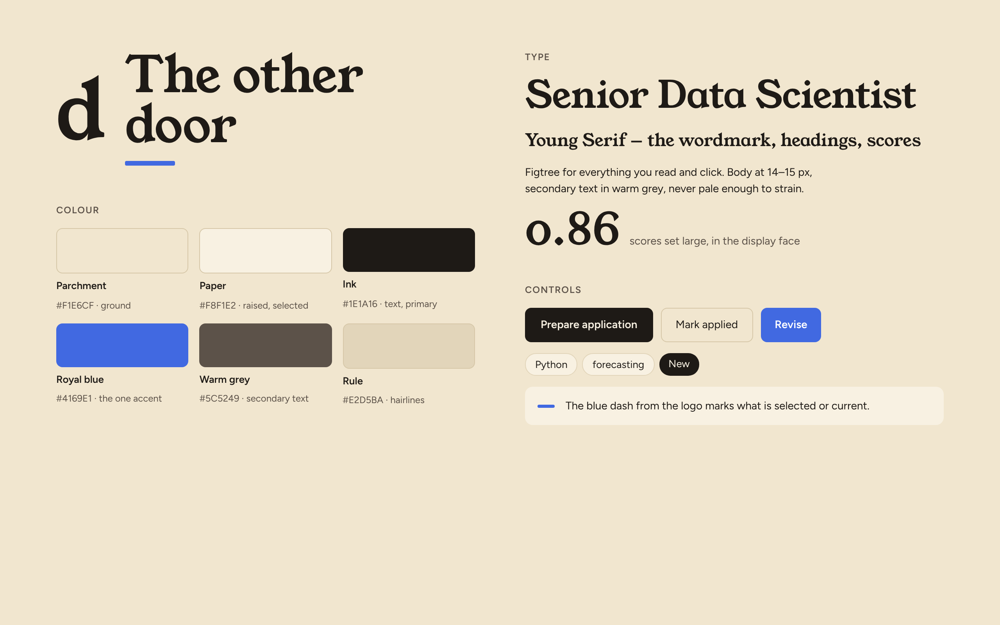
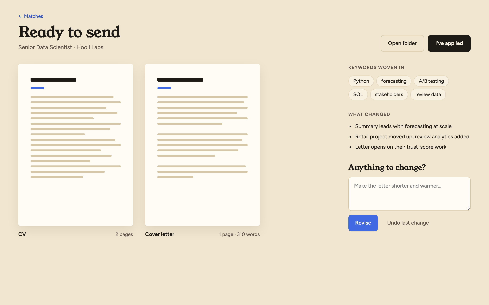
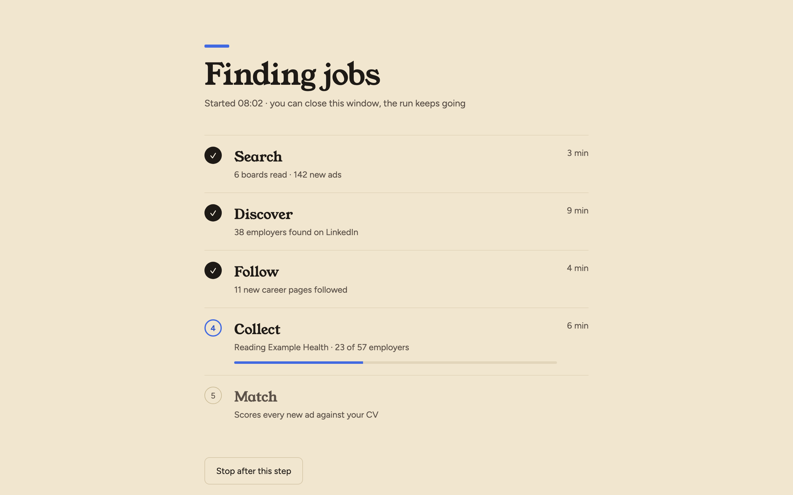
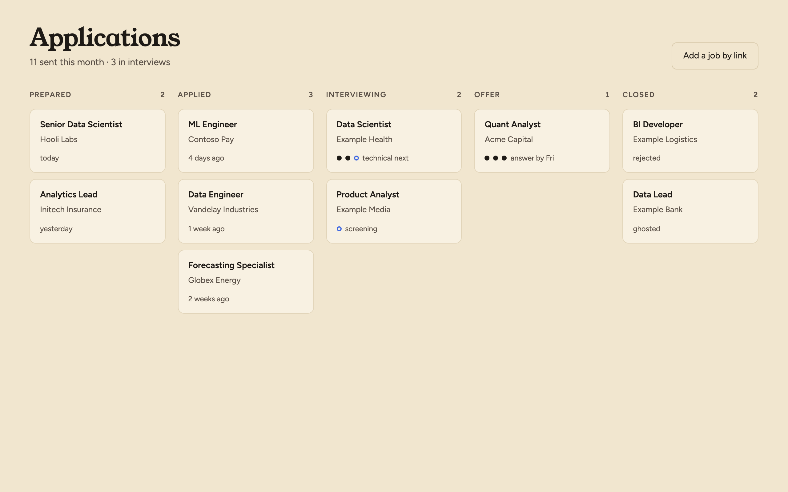
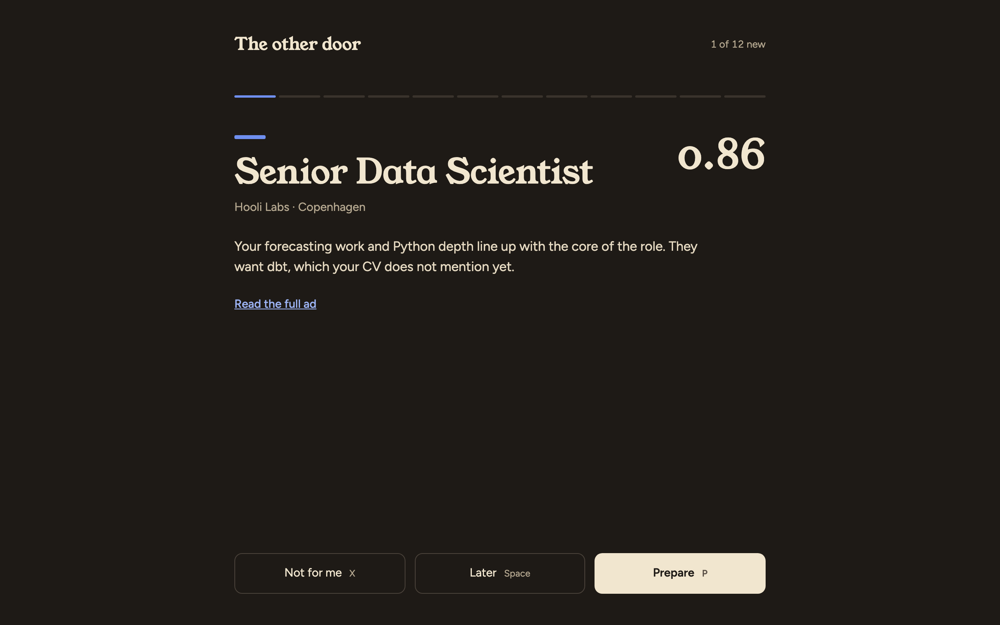
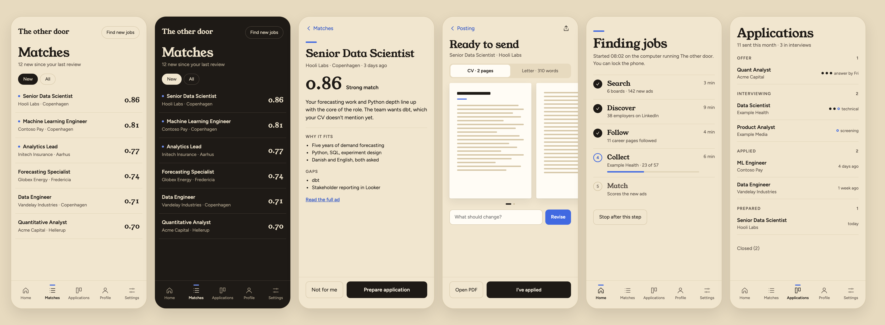

# The other door's visual design

The look of the desktop app (#215) and the phone app that reuses its screens (#303). It
comes from the logo (`docs/logo/door.svg`): parchment paper and a dark ink serif `d`
(Young Serif) over one short royal-blue bar, which is also the interface's signature. The aim is a quiet, clean
reading tool: lots of space, one accent colour, no decoration that doesn't carry meaning.

The values are in [`tokens.json`](tokens.json); the app's theme is generated from it, so
change a colour or a size there, not in a component.



## Principles

1. **Paper and ink.** A warm parchment ground, near-black ink text. No gradients, no
   glassy panels, almost no shadows (only dialogs and the run's summary card).
2. **One accent, used sparingly.** Royal blue marks what is current or in progress: the
   selected item, the running step, a progress bar, a new posting. If everything is blue,
   nothing is.
3. **Serif for what you read first, sans for the rest.** Titles and scores are set in the
   display face, everything you scan or click in the text face.
4. **The score is the hero.** Every list and posting shows its score as a large number in
   the display face, never as a coloured badge.
5. **Thin lines, not boxes.** Panes are separated by 1 px hairlines; lists are rows,
   not cards (the applications board is the one place with cards).
6. **Words, not ids.** A posting is its title and company; a step is its name and what
   it is doing. No job ids, paths or status codes on screen.
7. **Profile is what, Settings is how.** Profile holds who you are and the jobs you want: your details, the
   city and languages, what to look for and what to skip, the CV and the stories; changing it changes which
   jobs you get. Settings holds how *The other door* works for you: what it connects to, where it looks and
   what it may spend on your plan (Connections, Risky sources, your data). Where a
   key is stored (`profile/config.json` or not) does not decide it. A key nobody needs to touch is left to
   `config.json` (its default) and shown nowhere.
8. **No new destinations.** The sidebar is Matches, Applications, Profile, Settings and Analytics,
   and stays that. A new feature is an action on something already shown (a job, the CV), a section of
   an existing screen, or left to the command line, Claude Code and "Ask about your jobs" (#339).
   Analytics (#64) holds what is read, not changed: how it is going, as figures (what Claude's work
   cost, the market, how the applications go); an action there takes the user to where the change is
   made (Profile, a job).
9. **An error only when it helps.** Show an error only if it keeps the user from doing something
   wrong (a CV claim nothing backs, a value that will not save) or they can act on it and fix it
   themselves (sign in again, retry, choose a file). A failure the app retries by itself, or one the
   user can do nothing about, is said nowhere: a site a run could not read, an ad it could not score
   (#478). The run record and the logs keep it. The same failure again and again is something the
   user can act on (send a report, #593): one line, "Something keeps going wrong. Send a report".

## Colour

| Token | Light | Dark | Use |
|---|---|---|---|
| `ground` | `#F1E6CF` | `#1E1A16` | window background, text on an ink fill |
| `surface` | `#F8F1E2` | `#2A2520` | selected row, chips, cards |
| `page` | `#FFFCF5` | `#36302A` | document previews, text inputs, text on an accent fill |
| `ink` | `#1E1A16` | `#F1E6CF` | text, primary buttons, the logo |
| `ink-muted` | `#6B6157` | `#A59A85` | secondary text, labels |
| `border` | `#D6C7A8` | `#4A423A` | every line: hairlines, card, button and input borders |
| `accent` | `#2F55C8` | `#86A0F2` | the one blue: links in text and blue words, the dash, progress; never a button fill; not the back links (← Matches), which are `ink-muted`, `ink` on hover |
| `success` | `#3F6B4F` | `#7FA37E` | the circle of a done step or connection, the check of a board or source read (a mark) |
| `danger` | `#B3261E` | `#F2877F` | the cross of a board or source that failed, and before every error (a mark) |
| `warning` | `#E8C04F` | `#E6CB78` | the triangle before a line that needs you (a mark; its words carry the meaning) |
| `on-warning` | `#1E1A16` | `#1E1A16` | the ! on that triangle |
| `scrim` | `rgba(30,26,22,0.4)` | `rgba(0,0,0,0.55)` | the veil behind a dialog |
| `accent-tint` | `rgba(47,85,200,0.14)` | `rgba(134,160,242,0.35)` | the accent, faint, behind text: the lines just added to the CV (stronger in dark, where the ground swallows it) |

Contrast (WCAG): ink on ground 14:1; ink-muted on ground 6.1:1 (6.8:1 on surface);
accent on ground 5.2:1 (6.3:1 on page), page on accent 6.3:1; in dark mode ink-muted 7.4:1,
accent 6.9:1 on ground and 5.2:1 on page, page on accent 5.2:1 (white would be 2.5:1, so text on a
blue fill is dark there); success on ground 5.0:1 and danger 5.3:1 (6.1:1 and 7.0:1 in dark). One blue
serves words and marks alike, every use above 4.5:1. `border` is
every line, hairlines and control outlines alike (one token: `rule` was nearly the dark `page`, so
lines vanished on cards); text on an ink fill is `ground` in both themes.

Statuses are not colour-coded. A status is a word (Applied, Interview, Offer…), and
colour never carries meaning on its own: `success` and `danger` colour a ✓ or ✕ that says
the same thing by its shape, and `warning` a triangle with a ! beside words that say what is wrong.

## Type

- **Young Serif** (display; 400, its one weight), a warm, soft serif: headings and scores.
  Fallback: Georgia. One exception: the app's name wherever it is on screen
  (`AppName`, `named()` for a message that may name it), in the colour of the text around it, so it reads as a name
  and not as a phrase. Plain-text places cannot carry it: window titles, system notifications.
- **Figtree** (text; 400, 500, 600), a clean geometric sans for everything you read and click.
  Fallback: `system-ui`.
- Both are under the SIL Open Font License; the app ships them in the package (no font
  fetched at run time, so it works offline).
- Scores, counts and times use tabular figures (`font-variant-numeric: tabular-nums`).

| Style | Size / line | Face | Used for |
|---|---|---|---|
| display-l | 40 / 1.1, −0.01em | Young Serif 400 | every title: each screen's ("Matches", "Finding jobs"), the wizard's, the open posting's, the run summary's |
| display-s | 22 / 1.3 | Young Serif 400 | every heading under a title: a part's heading, with space above it and no rule (the review, Profile, Settings), step names, dialogs |
| score-l | 56 / 1 | Young Serif 400 | the open posting's score |
| score-s | 20 / 1 | Young Serif 400 | scores in lists |
| body | 14 / 1.5 | Figtree 400 | all reading text: the default, subtitles, the posting's lines, field names |
| small | 13 / 1.45 | Figtree 400 | everything smaller: company · place lines, chips, captions, notes, the sidebar's lines |
| label | 12, +0.08em, uppercase | Figtree 600, ink-muted | section labels and the groups inside a part |
| field-label | 14 / 1.5 | Figtree 500, ink | a field's name, in every form (the wizard, Profile, the dialogs); never uppercase |

## Space and shape

- Spacing steps: 4, 8, 12, 16, 20, 24, 32, 40, 48, 64 px, and 6 px (`size.gap-s`) between a thing and what belongs to it: a mark and its words, pills in a row. Corners: `radius-s` 4, `radius-m` 8, `radius-l` 10, and `radius-pill` for anything rounded at its ends (pills, chips, bars, the dash). Every screen's title sits 40 px from the top (`size.screen-top`) and 40 px from the sidebar (`size.screen-gutter`), on every screen: Finding jobs is a 620 px column on that same edge, not centred; Profile and Settings fill the width up to a fixed list of their sections on the right (220 px with its gutter, level with the title; the part in view in ink with a short blue bar on the list's rule), left out below the sidebar breakpoint. Screen padding 40–48 px (20 px on a phone; `tokens.json` `phone` holds the phone sizes).
- Radii: 4 (document pages), 8 (buttons, inputs), 10 (rows, cards), pills for chips.
- Controls are at least 44 px tall. Chips and filter pills are 32 px.
- Buttons answer the pointer with a 120 ms colour change, one rule per kind: primary turns `ink-muted`, secondary and quiet take an ink border or ink text over a `surface` fill, pills an ink border, sidebar items the `surface` fill; pressed, secondary and quiet fill `border`; a disabled button does not react, and a touch screen shows no hover. The preview's `?scene=guide` shows them all.
- Reading width: the posting pane fills its column, so a long ad uses the window it is given; the score reason keeps a 60-character measure. (`size.content-max-width`, 760 px, is no longer applied to the posting.)

## The blue dash

The short royal-blue bar (the one under the logo's `d`) is the app's one signature. A rounded blue bar sits **above**
what is current:

- 40 × 5 px above a full-screen title and the review card (not above a posting's title, nor Ready to send's or What
  you sent's);
- 6 px blue dot before the title of a posting that is new since the last review (instead
  of a ✦ glyph).

It is never a left border on a card, and never used as decoration where nothing is
selected.

## Components

- **Primary button**: ink fill, `ground` text, 600 weight, radius 8, height 44. One per view
  ("Prepare application", "I've applied").
- **Order of buttons**: in a row that ends a step (a dialog, a form, a confirmation, a wizard's screen), the way out comes first (Cancel, Back, Skip, Not now, Undo changes) and the main action last, on the right, as macOS orders them. A row of actions that all go forward, with no way out (Draft from my CV, Add a story), starts with the main one.
- **Secondary button**: transparent, `border` outline, ink text.
- **Quiet button**: no border, `ink-muted` text ("Not for me", "Undo last change"). Only beside a bordered button, which shows the row is buttons (Cancel next to Save); an action standing alone, such as Edit and Remove under a story or an employer, is a secondary button.
- **Dialog or in place**: a dialog for a short task about one thing that leaves the page as it was: a few fields and one answer (Add a job, Edit story, Write a story, Add a page), a confirmation before what cannot be undone, a document to read and close. Its title names the action; Esc or Cancel leaves; the main action is last. Only a confirmation opens over a dialog. In place for what is long, open-ended or worked alongside: many items to review (the drafted stories), a result that stays (the learning plan), a run (Finding jobs), a tool beside what it changes (Revise beside the pages).
- **Inline link**: `accent` text, underlined, the size and weight of the sentence it is in (the Markdown cheatsheet beside "Your CV", "Draft it from your CV file or pages" in a note, a salary's source). Only a word inside a sentence that opens or shows something; an action on its own line is a button.
- **Filter pill**: 32 px, `border` outline; the active one is ink-filled.
- **Chip**: `surface` fill, `border` border, small text (keywords). A posting's skills are not chips: each is a line with
  a mark, the green check for one that fits and the red cross for a gap, as Finding jobs marks its sources; the fits and
  the gaps side by side, each in two columns of its own, with no heading (the marks say which is which).
- **Switch**: one setting on or off, its name to the right (the CV's Preview, on over its Markdown). A 36×20 track, `border` when off, `ink` when on, its round thumb (`ink-muted` off, `ground` on) sliding across in 120 ms; the whole line is the control, 44 px tall. Pills choose between several views; a switch turns one thing on.
- **Note and error**: one box, `surface` fill, `border` outline, ink text. A note (`notice`: Stopped, Marked as applied) is only the box; an error (`error`: Import failed) starts with the ✕ mark in `danger`, so a failure shows at a glance. A field's own error is bold ink under the field, with no box (`field-error`).
- **List row**: title (15 / 600), `company · place` in small `ink-muted` beneath, score-s on
  the right; selected = `surface` fill plus the small dash.
- **Step row** (a run): a 28 px circle (`success` with a right-angled check when done, accent ring with the number
  when running, `border` ring when waiting), the step name in display-s, what it is doing
  beneath, elapsed time on the right; the running step gets a 4 px accent progress bar.
- **Document preview**: a `page` sheet at A4 ratio, no shadow, caption beneath
  (name left, page count right).
- **Section label**: the `label` style, 10–12 px above its content.
- **Field name** (`field-label`): 14 px, Figtree 500, ink, sentence case, 4 px above its box; 28 px between fields. What a box means is in an info bubble (`ink` fill, `ground` text, in both themes) beside its name and how to use it is its placeholder (`ink-muted`); under a box go only its pills, one line each, and its errors. A checkbox's own line stays visible, because some carry terms warnings.
- Icons: thin stroke icons (1.5 px), `ink` or `ink-muted`; no emoji.
- Checkboxes and radios: custom, 18 px, `page` fill with an `ink-muted` line; on, a checkbox fills with `ink` and the right-angled check, a radio gets an `ink` dot.
- Folded sections: the same thin chevron, right when closed, down when open, centred on the line.
- Dropdowns: the field's look with a thin right-angled `ink-muted` chevron; the open list stays the system's.
- Focus: a text field or dropdown has no ring: its border turns `accent` while it is active. Buttons, links, checkboxes and radios keep the ring.

## Layouts

The screenshots below are rendered from the mockups in [`mockups/`](mockups/) (see
[Mockups](#mockups)); sample companies and numbers are made up. The same mockups are on
the design canvas (<https://claude.ai/artifact/4UWNSV9JgaPXX4LZxPL1S5>, private until
shared from its Share menu).

What needs you (Claude not signed in, no CV, a failed Drive sync or one that needs a choice, something that keeps going
wrong) is a short underlined line each at the foot of the sidebar, under the last run, opening
where it is fixed; nothing when all is well. The app opens on Matches.

**Matches** (the home of a review session): the list, and a row opens its posting on the
whole page, as a card does in Applications. The list stops at 620 px, the column of Settings and Finding jobs, so a row reads as one
line; the header spans the page, "Add a job" on its right as in Applications. A row has a
`surface` background on hover, and keeps it for the posting last opened when you come back.
The new dot goes once a posting is opened. (The mockup and `screens/matches.png` still show
the earlier three panes.)

```
┌──────────┬──────────────────────────────────────────────────────────────┐
│          │ Matches                                          [Add a job] │
│ Matches  │ (○ New only)                                                 │
│ Applic.  │                                                              │
│ Profile  │                                                              │
│ Settings │ • Senior Data Scientist                                 0.86 │
│          │   Hooli Labs · Copenhagen                                    │
│          │ ML Engineer                                             0.81 │
│[Find new]│   Contoso Pay · Copenhagen                                   │
└──────────┴──────────────────────────────────────────────────────────────┘

┌──────────┬──────────────────────────────────────────────────────────────┐
│          │ ← Matches                                      2 of 14  ‹  › │
│          │ Senior Data Scientist                                        │
│   …      │ Hooli Labs · Copenhagen · posted Oct 31 · via Jobindex       │
│          │ 0.86 ⓘ                                                       │
│          │ [Prepare application] [Open in browser] [Status] Not for me  │
└──────────┴──────────────────────────────────────────────────────────────┘
```

‹ › and the j and k keys step through the list, Esc goes back; Not for me opens the next
match in its place.

**Prepared application**: title "Ready to send" with the job beneath; one document at a
time, large enough to read, behind a CV · pages | Letter · words switch, its pages scrolling in
their own column (the mockup's two small side-by-side previews were too small to read); on the right, "Anything to change?" (a text box, Revise, Undo); What you sent has no right column.
Primary action: "I've applied".



**Finding jobs** (a run): one column, 620 px, on the screen's left edge. Title, a line that the
screens can be switched while it runs (quitting stops it), then the five steps (Search, Discover, Follow, Collect, Match) as step
rows. One secondary button: "Stop" (the run has no graceful cancel, so it ends the run at once and says nothing is lost).
When it ends, a summary card replaces the button. With no new match it states the run in one line and offers actions that open Profile sections (employers, the bar, the search terms), no new destination.



**Applications**: five columns, Prepared, Applied, Interviewing, Offer, Closed (rejected,
ghosted, discarded), with plain cards (title, company, when). Interview rounds are dots
on the card: ink = passed, accent ring = next. The board scrolls sideways in its own box
on a narrow window.



**Review, one at a time** (an optional focus mode, dark): one posting per screen, centred,
with a thin progress strip of the new matches, the score large on the right, and three
wide buttons with their keys: Not for me (X), Later (Space), Prepare (P).



**Analytics** (no mockup yet): the reading-width column of Settings with its list of parts on the
right, nothing in it changes anything. Claude usage first: the total of the last 7 days in
`display-s` with one small muted line under it (at API prices, not a bill, and about what one search
and one application cost), then each activity (largest first) as a row, its name left and its
dollars right in tabular figures with what it did just before them in `small` muted, a 4 px
`.bar` for its share of the total under them, and its features as quieter `small` rows when there are several.
Not the plan's 5-hour window: that is live, and this screen is about the days gone by. Before any call, one muted line. Not on the phone.

**Onboarding** (no mockup yet): the first-launch wizard has no sidebar. One 620 px column,
centred (there is no sidebar to line up with), under a strip of thin segments (ink for the steps done, the blue for
the current one, `border` for the rest). Each step has the Young Serif title (no blue dash: the current segment already marks where you are),
one primary ink button, and Back and Skip as quiet buttons beside it. Connect Claude comes first, only when Claude is missing or signed out (one action, and a fourth segment), and moves on by itself. Then three screens: Tell me about yourself (the sources: one line in a drop zone, `surface` fill with a dashed `border` line, that also opens the file dialog, a URL field with only a placeholder, each with an info icon whose words open on hover or focus), Reading (the step rows of Finding jobs, asking nothing), and Check your answers (a note naming what could not be found, parts each under its heading with no rule, a What matters to you text box with no label of its own (optional), Search terms and CV folded; the CV is
a textarea in the page colour). Save leads to Finding jobs.

### Phone and narrow windows

The phone app (#303) is the same renderer, so it uses the same tokens, type and
components; only the layout changes below the sidebar breakpoint (`size.sidebar-breakpoint`, 900 px; the `phone` sizes reach the renderer as `--phone-*` variables):

- **Tab bar** instead of the sidebar: Matches, Applications, Profile, Settings, Analytics (the paired
  phone has only Matches, Applications and Settings: the profile, the CV and the employers
  are changed, and Analytics read, on the computer running *The other door*), each a
  22 px stroke icon over an 11 px label; the active tab is ink and 600 weight with the
  small blue dash above its icon. 22 px of bottom padding clears the home indicator.
- **Pushed screens**: list → posting → materials, each with a back link naming the screen
  it returns to ("← Matches"). Pushed screens hide the tab bar and put their actions in a
  bottom bar: one primary ink button filling the width next to one secondary button
  ("Not for me" | "Prepare application", "Save CV" | "I've applied").
- **Matches**: one list, rows separated by hairlines, the new dot before the title; the
  score stays on the right in the display face. "Find new jobs" is a small outlined pill
  in the header (the phone has no sidebar foot), beside "Add a job".
- **Ready to send**: a two-way switch (CV · pages | Letter · words) above the pages, which
  swipe sideways with the next page peeking in; Revise is one text field with the accent
  button beside it; sharing the PDF is the icon in the header. The desktop app uses the same
  switch, and it also picks the document Revise changes.
- **Finding jobs**: the same step rows, smaller (19 px step names); it says the run is on
  the computer running *The other door* and the phone can be locked.
- **Applications**: the board becomes a grouped list (Offer, Interviewing, Applied,
  Prepared; Closed collapsed at the end), the interview dots right-aligned on each row.
- Type steps down one size (titles 36 px, headings 19 px, the posting's score 48 px);
  body text stays 14–15 px.



## Dark mode

Follow the system setting, with an override in Settings. Dark swaps the ground and ink
(ink `#1E1A16` becomes the ground, parchment the text) and uses the lighter blues from
the table; the layouts and components stay the same.

## Logo

`docs/logo/door.svg` (512 × 512, with its parchment tile) is the app icon: the ink `d` with the
blue bar under it, a pill as wide as the `d`'s bowl and stem. `door-512.png` and `door-120.png` are it
rendered; the phone app's icons (`app/src/web/public/icons/`) are the same, full-bleed for
`apple-touch-icon.png` and inside the safe zone for `maskable-512.png`. Neither the logo nor the
product's name appears inside the app's screens, except on the splash while the window starts, where
the bar grows and shrinks.

## Mockups

`mockups/<Screen>.dc.html` (desktop) and `mockups/Phone<Screen>.dc.html` (phone, 390 × 844)
are the design canvas's artboards: HTML with `{{…}}` holes,
`<sc-for>` and `<sc-if>`, filled from the sample data in each file's script.
`mockups/support.js` is a small static renderer for them (a query string such as
`?dark=true` overrides a declared prop, which is how the dark phone shot is made), and `mockups/render.js` writes
the screenshots with Playwright's Chromium (not a dependency of the app: it needs Node and
`playwright` installed where Node finds it, and network access for the fonts):

```bash
node docs/design/mockups/render.js   # rewrites docs/design/screens/*.png: desktop 2560 × 1600,
                                     # phone 780 × 1688, and phones.png (all phones side by side)
```

They are references, not app code: the app (#219) builds its screens in React from
`tokens.json`. When the design changes, update the mockup, re-render, and update this page
and `tokens.json` together.
